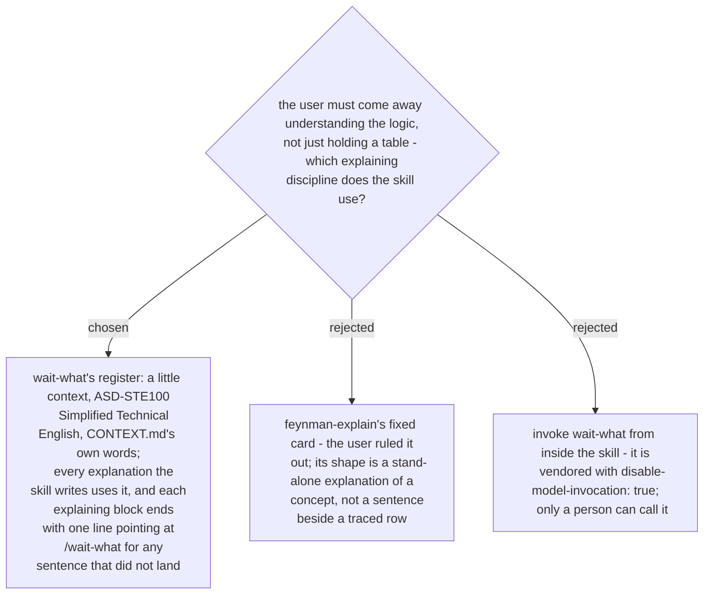

# The provenance check teaches in wait-what's register, not feynman's card

The user said, on 2026-10-29, "ไม่ใช้ feynman ใช้ wait what". `wait-what` is a one-line vendored
skill that re-pitches the last message with a little context, in ASD-STE100 Simplified
Technical English, using the ubiquitous language from `CONTEXT.md`; it is marked
`disable-model-invocation: true`, so no skill can call it - the user types `/wait-what`.

The provenance-check skill (name pending) therefore writes in that register itself: every
explanation of a traced row - why the branch is there, what the value means, what the verdict
says - is short, in Simplified Technical English, and uses the project's `CONTEXT.md` terms.
It never calls `wait-what`; it closes each explaining block with a single line telling the
user to type `/wait-what` on any sentence that did not land, so the repair path stays the one
the user already knows.
