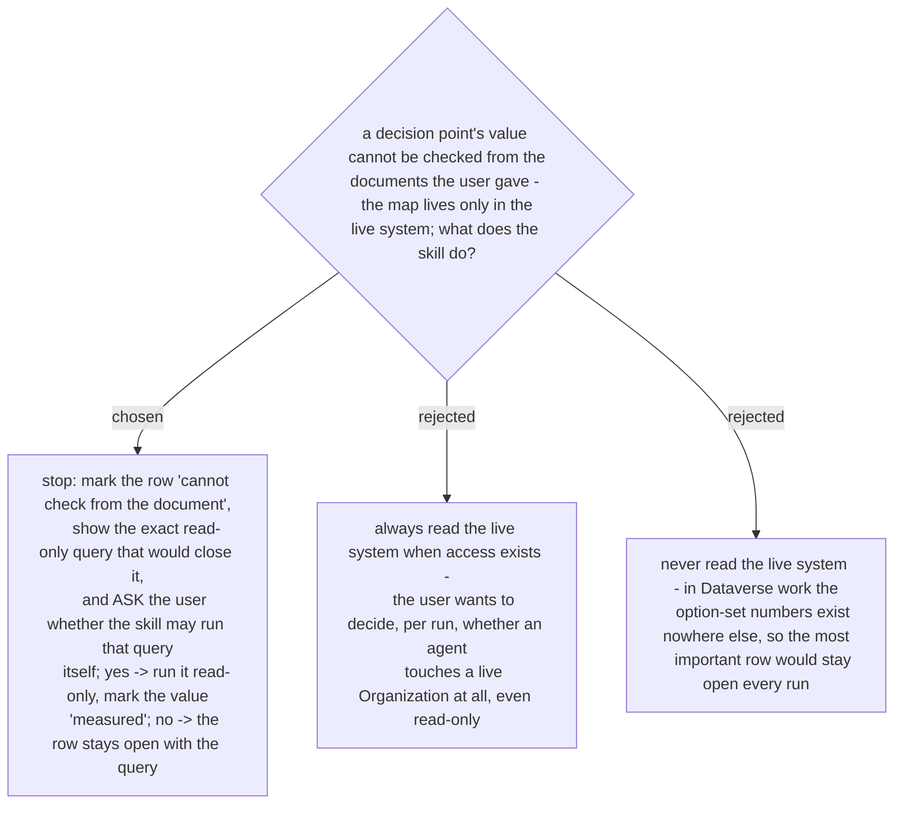

# A row the documents cannot close stops by default, and the live read is offered, not taken

> **Amended 2026-10-29 by ADRs 0272 and 0275:** a query output the user runs and pastes is *measured* (run by who, date), not *told*; and "once per run" means once per query - a yes is never carried to another row or another run.

Decided 2026-10-29 on the `Elevate` #151 example: the spec names the `mgw_loggingstatus`
values (`Creating`, `Created`, `Partial`, `Failed`) and the story uses numbers
(`914120001`, `914120003`); only the live Dataverse holds the map between them. The user
chose "A by default, and ask the user whether to let the AI do B".

So the skill never opens a live system on its own. A row the documents cannot close is
reported as such, with the one read-only command that would close it, and one question:
run it? On yes, the skill runs exactly that query, read-only, and marks the result
*measured*; a value a person states instead is marked *told*. On no, the row stays open and
the command stays in the report for the user to run later. The ask is per run, not a
standing permission.
