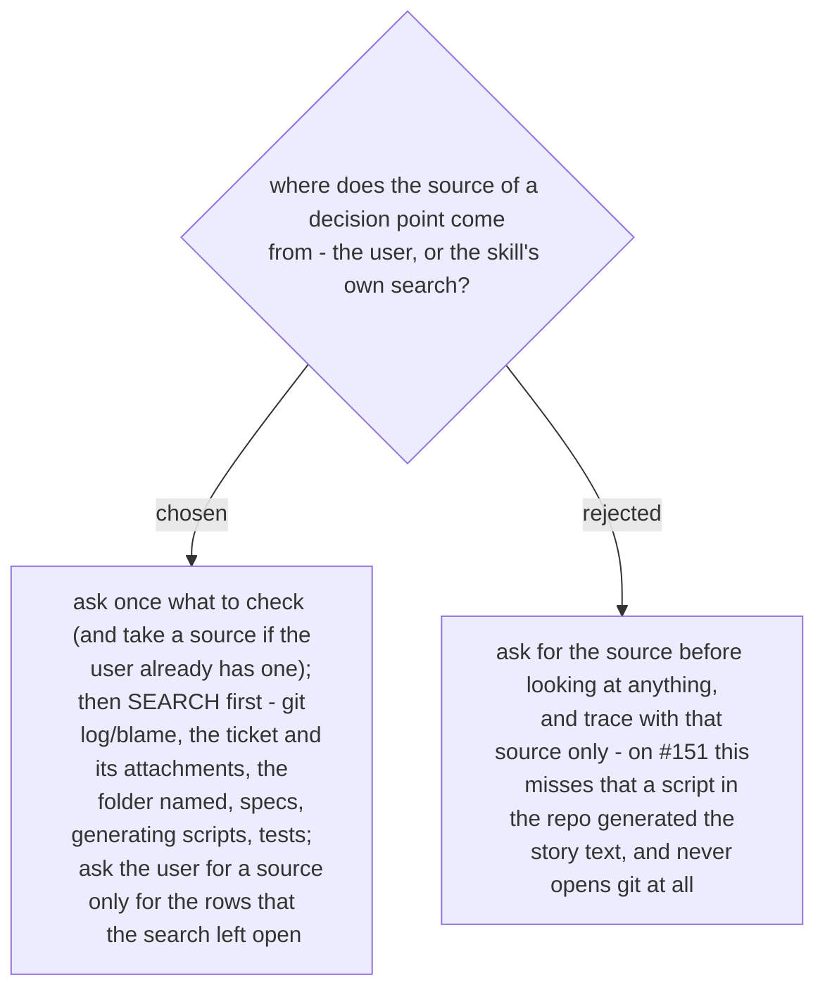

# The provenance check searches before it asks, and asks only for the rows still open

The user's first plan (2026-10-29) was two asks in a row: what to check, then where the
source is. Tracing `Elevate` #151 showed the order is wrong: the story's text was generated
verbatim by `scripts/populate_teams_agent_backlog.py`, and the spec that defines the field
sat in the folder the user named - both found without a second question. The user chose B,
search first.

So the skill asks one opening question - what to check, plus any source the user has at
hand - then searches on its own: `git log -S` / `git blame` on the thing, the ticket and
its attached images (via `ticket-trace` and `read-picture`), the folder or document the user
named, specs, the scripts that generated the artefact, tests. It returns the table with every
row it could close, and asks the user for a document or a person only for the rows still
open. The user's one source is a head start, not the whole search.
