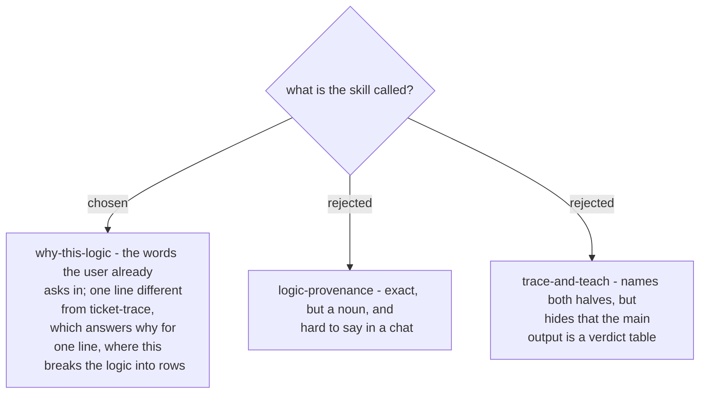

# The provenance check is named `why-this-logic`

Chosen 2026-10-29. The skill lives at `plugins/dev-workflows/skills/why-this-logic/` and is
invoked as `/why-this-logic <thing> [source]`. ADRs 0261-0264 that say "the provenance-check
skill (name pending)" mean this skill.
