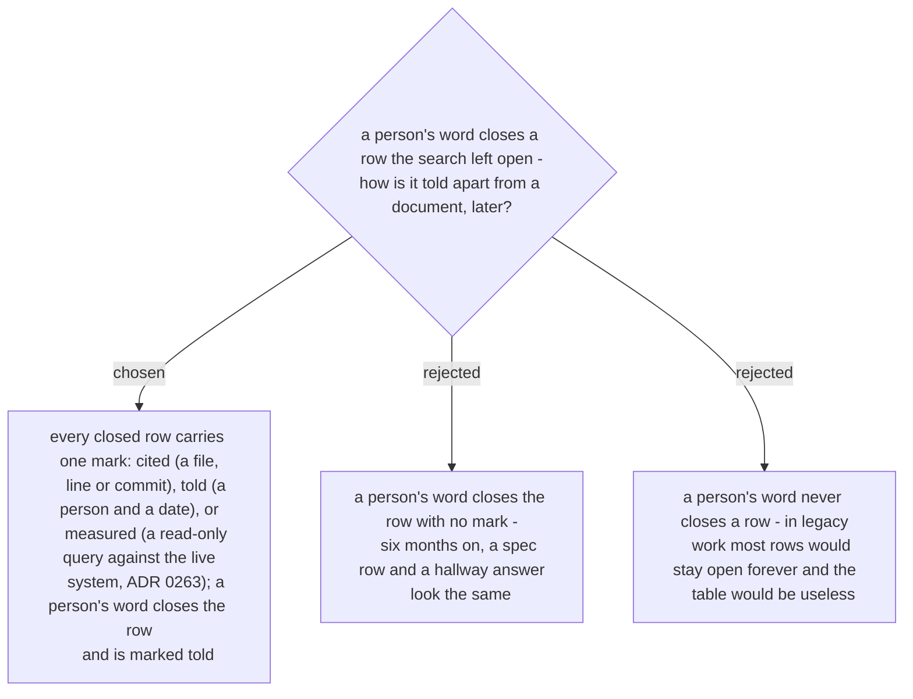

# Every closed row carries one of three proof marks: cited, told, measured

> **Corrected 2026-10-29 by ADR 0272:** the marks are not identical to architect-and-verify's - there an old document is *told*; here a document or commit is *cited*. A pasted query output is *measured* in both.

> **Amended 2026-10-29 by ADR 0280:** a *cited* row whose source is a document statement carries that statement's requirement ID — `cited R-003 (spec:145)`. The mark is unchanged; the citation gains an ID so the register (ADR 0278, 0281) can point back at the row.

Chosen 2026-10-29. `why-this-logic` writes one row per decision point (ADR 0261). A row is
closed by a document or git (*cited*: file and line, or commit), by a person (*told*: who
and when), or by the live system (*measured*: the query, run read-only after the user
said yes, ADR 0263). The three marks are the same three `architect-and-verify` uses for
its facts, so a reader who knows one skill reads the other.

Example: Workflow 3's `7 days` is `MG_ReminderAgeDays (7)` in the spec - *cited*. Had the
spec not said it and the user answered "Mark wanted 7", the row would close as
*told: user, 2026-10-29*. Both rows are closed; the mark is what differs, and the mark is
what a reader needs six months later.
