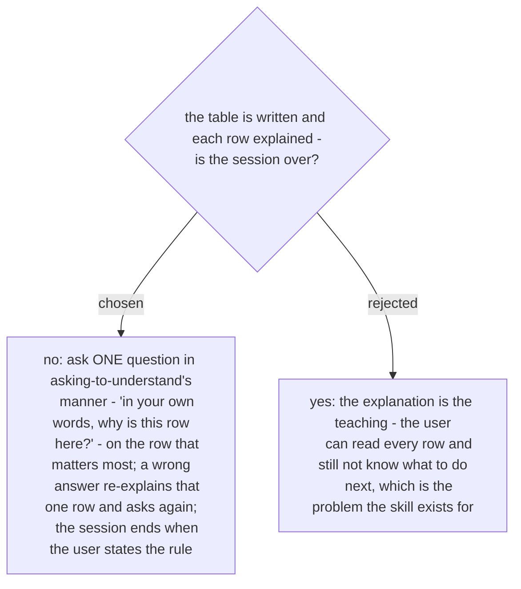

# `why-this-logic` ends when the user states the rule, not when the table is written

Chosen 2026-10-29. The user's requirement is that they come away understanding, not holding
a document. So after the table (ADR 0261) and the row explanations in wait-what's register
(ADR 0262), the skill asks one grounded question on the most consequential row - the one
marked *no source* or *contradicts* if there is one - and listens. A wrong answer gets that
one row explained again and the question re-asked; it never dumps a list of questions.

**The explanation always comes before the question.** The skill never asks the user about a
row it has not yet explained: first the table, then each row in plain words (wait-what's
register, ADR 0262 - what the row is, where it comes from, what the verdict means), and
only then the one question. A question asked before the explanation tests memory, not
understanding, which is the failure the user named on 2026-10-29 ("อธิบายให้ฟังก่อนถาม").

The close is borrowed from `asking-to-understand` (one grounded question per turn, ends
when they state the rule), not a full invocation of it: the skill asks about its own rows,
with its own evidence already on screen. On `Elevate` #151 the question is "why are only
two of the four statuses in the filter?", and the rule the user must reach is "this filter
has no source yet, and the numbers are unverified".
