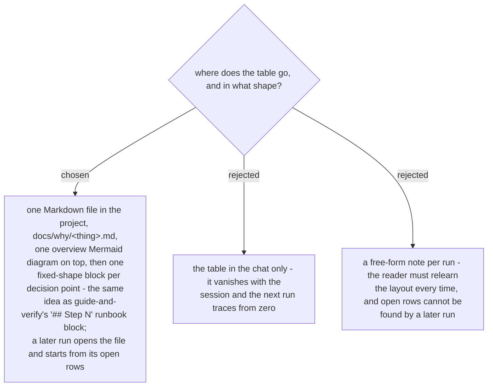

# `why-this-logic` writes one Markdown file with a fixed block per row, in guide-and-verify's shape



> **Superseded in part 2026-10-29 by ADR 0274:** the file is no longer written only at the close - its skeleton is written after the rows are listed, filled as found, completed when the rows are explained, and updated by the close. Path and block shape unchanged; ADR 0276 adds the *Still to answer* header line.

Chosen 2026-10-29. The user asked for "an md file that notes steps, like guide-and-verify".
That skill's runbook works because every step has the same shape, the baseline is written
where it outlives the session, and the outcome line carries its measurement. `why-this-logic`
borrows all three. The file is `docs/why/<thing>.md` in the project being traced (for
`Elevate` #151: `docs/why/elevate-151-overdue-filter.md`); it opens with one Mermaid
overview per the diagram convention, then one block per row:

```
## Row N — <the decision point, quoted as written>

**Where:** <file:line | ticket #n | document path>
**Why it exists:** <one sentence, or "no document says">
**Source:** cited <file:line / commit> | told <who, date> | measured <the query> | none
**Verdict:** matches | contradicts | no source | cannot check from the document
**To close it yourself:** <the read-only command, the document to find, or whom to ask>
**In plain words:** <two or three sentences in wait-what's register>
```

The *Source* line carries the three marks of ADR 0266; *To close it yourself* carries the
query ADR 0263 leaves behind when the user declines the live read. A later
`/why-this-logic` on the same thing opens the file first and asks only about rows whose
verdict is still *no source* or *cannot check*.
