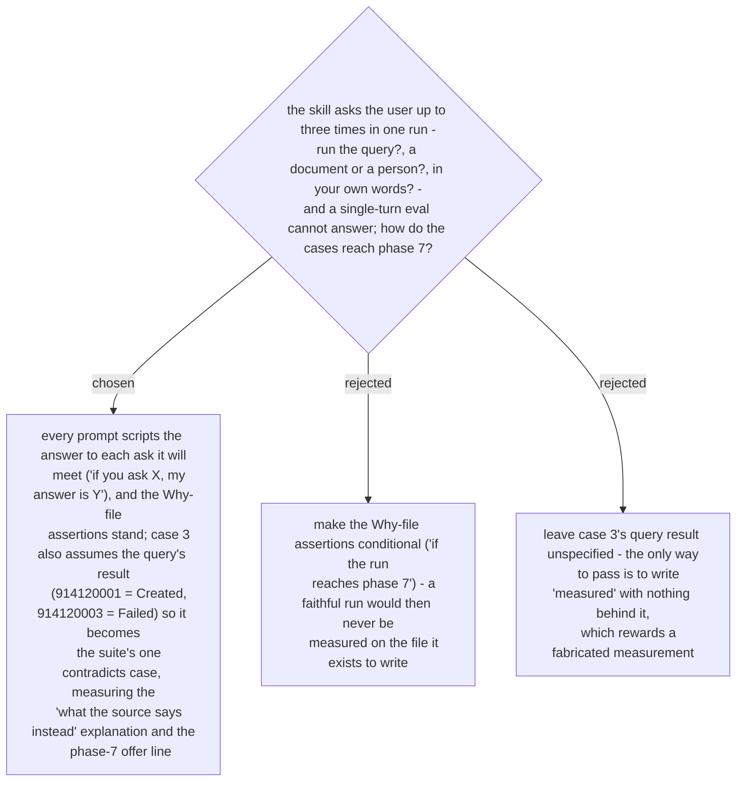

# An eval prompt scripts every answer the skill will ask for, and one case carries the `contradicts` verdict

Ruled 2026-10-29 during execution of the why-this-logic plan, when the Task 2 review read the
four eval cases against the committed `SKILL.md`. Three defects, all in the plan's text, not
the transcription: the case-0 assertions said "before asking any question" where the skill's
phase-3 asks (ADR 0263, 0264) legitimately precede the explanation and only the phase-6
question (ADR 0267) must follow it; no prompt scripted the phase-6 answer, so phase 7 - the
Why file (ADR 0268) - was unreachable in a single turn; and case 3 named no result for the
query it asks the skill to run, so `measured` could only be written on nothing.

The rule for every case from now on: the prompt scripts each answer the skill will ask for,
in the `guide-and-verify` manner ("Assume for this run: …", "if you ask, my answer is …").
Case 0 scripts "no" to the phase-3 document-or-person ask and the phase-6 rule; cases 1-3
script the phase-6 rule; case 3 also scripts the query's result, chosen to disagree with the
spec's intent (Partial skipped, Failed reminded), so the suite measures `contradicts`, the
"what the source says instead" explanation, phase 6's priority (contradicts first) and the
phase-7 one-line offer that files nothing. Spec §10 carries the amended rows.
