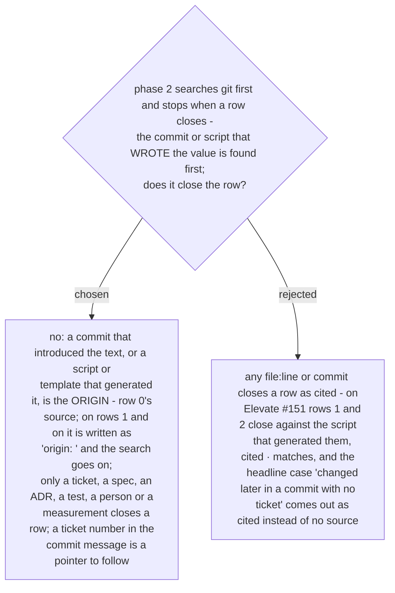

# The origin of the text is not a reference for any row but row 0

Ruled 2026-10-29 at the final whole-branch review. `SKILL.md` phase 2 said "stopping when the
row closes" and "a row closed here is cited: file:line, a commit hash". Traced on the spec's
own example, rows 1 and 2 closed against `populate_teams_agent_backlog.py:388` - a copy of
themselves - and eval case 1 closed `> 30` on commit `a1b2c3d` before the tests at search
order 6 were ever read. A value agrees with the commit that wrote it by construction; that is
provenance of the text, not a reason for the value.

So the origin hit is recorded on the row as `origin: …` and never closes it. Row 0 is where
the origin is the answer. ADR 0264's search order is unchanged; what changes is what counts
as closing.
