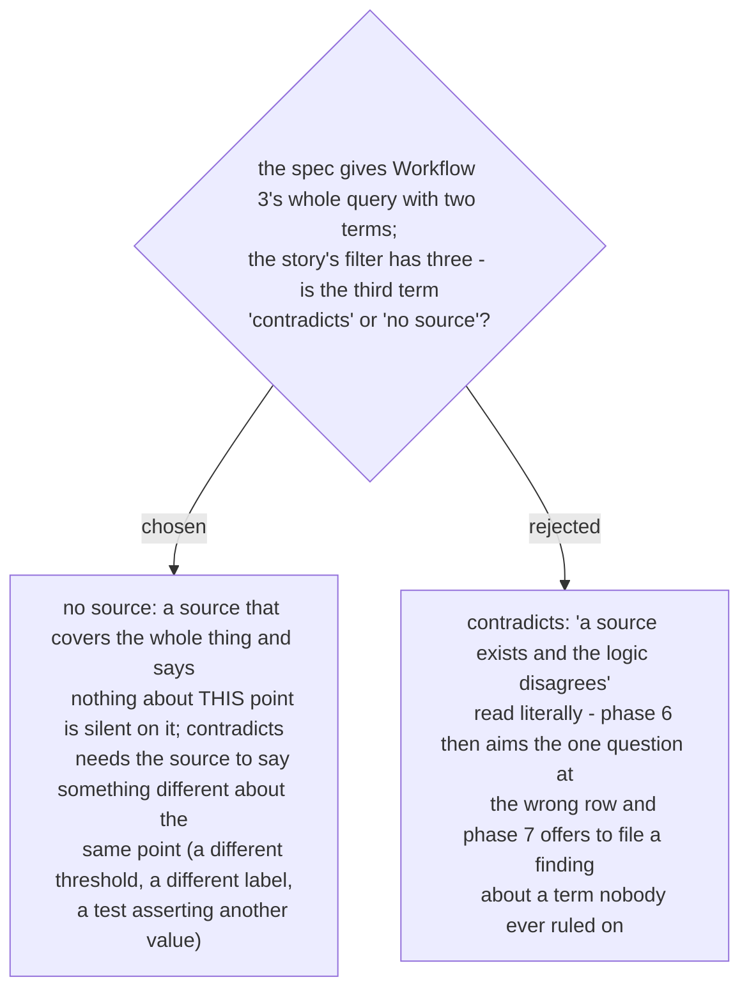

# A source silent on a point is `no source`, not `contradicts`

Ruled 2026-10-29 at the final whole-branch review. Spec §1 gives row 1 of `Elevate` #151 the
verdict *no source* ("the spec lists two filter terms and never names this field"), and
`SKILL.md`'s verdict table let an agent read the same facts as *contradicts*. The distinction
matters downstream: *contradicts* outranks *no source* in phase 6 and triggers the phase-7
offer line (ADR 0267, 0268). The rule is now one sentence under the verdict table.
