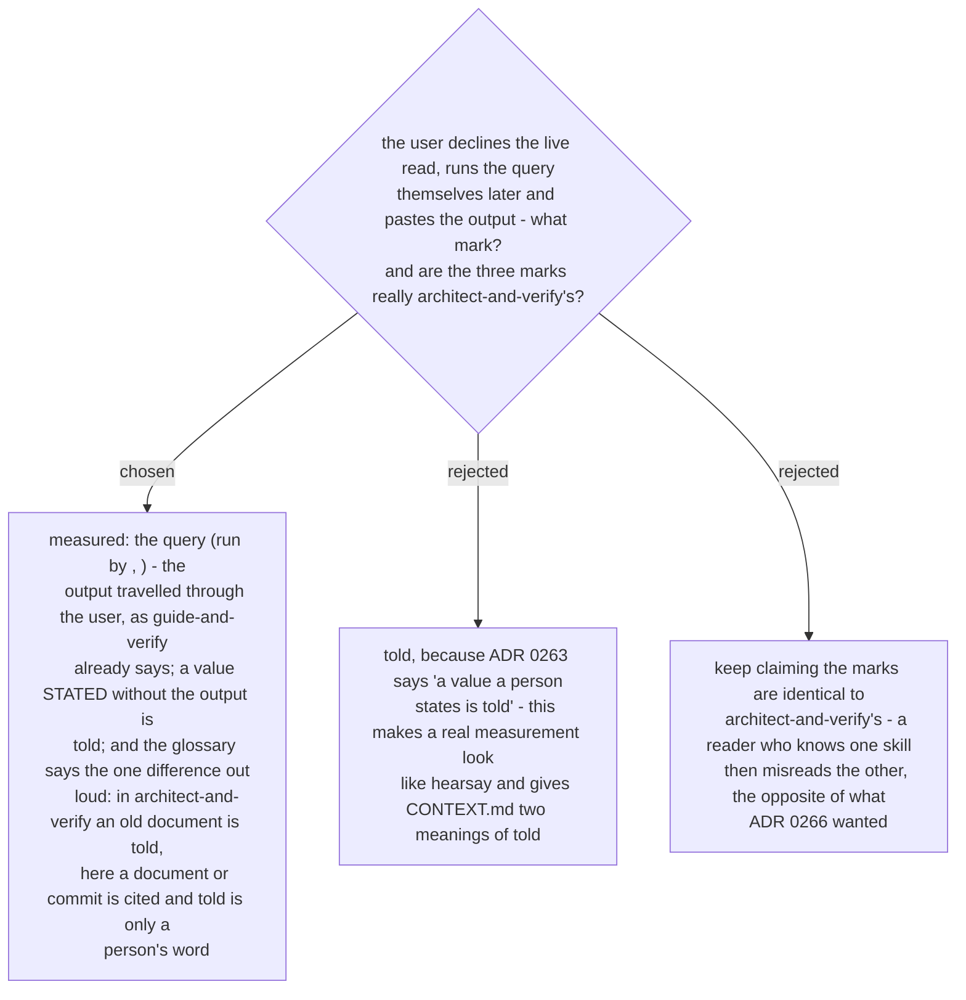

# A pasted query output is `measured`, and the marks differ from architect-and-verify's in one place

Ruled 2026-10-29 at the final whole-branch review. ADR 0266, spec §11 and `CONTEXT.md` said
the three marks "are the same three `architect-and-verify` uses". They are not:
`architect-and-verify` marks an old document *told*, and this skill marks a document *cited*.
And the path ADR 0263 leaves open - "the query stays on the row for you to run later" - had no
mark for the output the user brings back. `guide-and-verify` settles that: a pasted result "is
genuine measurement - it just travelled through them".

Corrections land in the same change: a banner on ADR 0266 and on ADR 0263, the `CONTEXT.md`
**Proof mark** entry, spec §11, and one sentence in `SKILL.md` phase 3.
