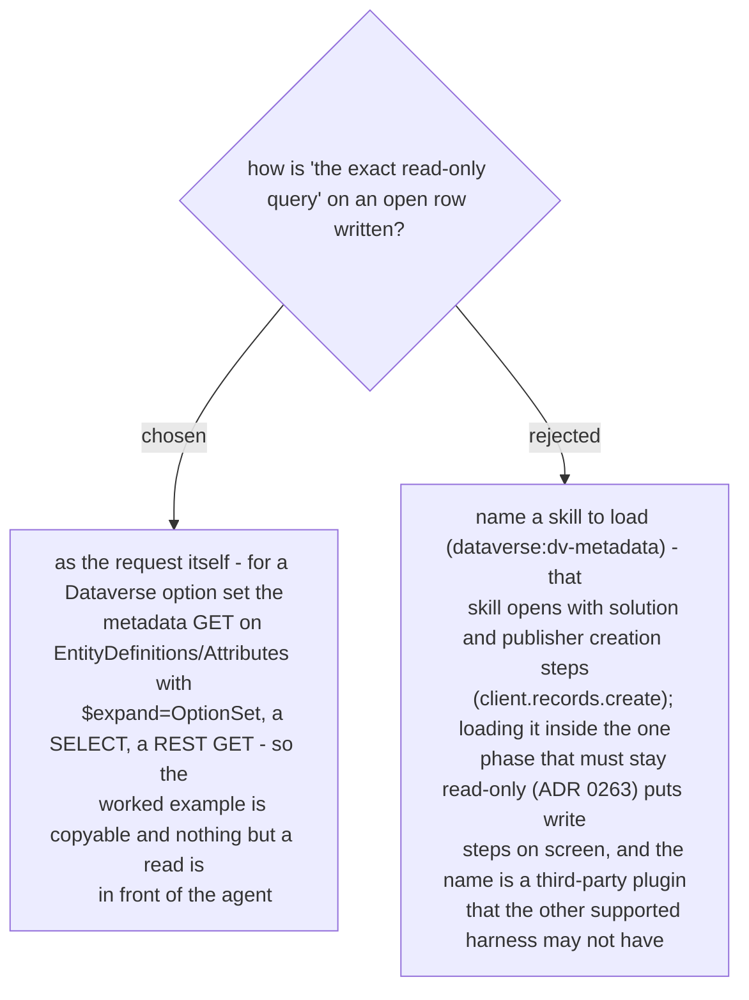

# The live read is an explicit read-only request on the row, never a loaded skill that carries write steps



Ruled 2026-10-29 at the final whole-branch review, which read `dv-metadata/SKILL.md:1-39` and
found it titled "Metadata - Making Changes". The spec (§4.3) and `SKILL.md` phase 3 named it
as the example; the worked block in `why-file-template.md` wrote `dv-metadata: … option set`
on the Source line, which is a description, not the query the template's own rule requires.
Both now carry the GET:

```
GET <org>/api/data/v9.2/EntityDefinitions(LogicalName='mgw_telephoneenquiry')/Attributes(LogicalName='mgw_loggingstatus')/Microsoft.Dynamics.CRM.PicklistAttributeMetadata?$expand=OptionSet($select=Options)
```
