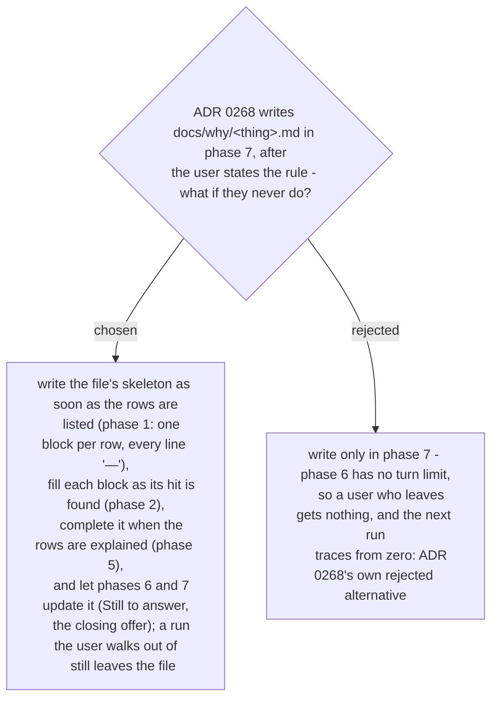

# The Why file is written when the rows are explained, and updated by the close - not written only at the close

Ruled 2026-10-29 at the final whole-branch review. `SKILL.md` borrowed `guide-and-verify`'s
"record each hit as it is found" rule and its rationale (a crash or a compaction loses an
unwritten search) - but "its row" was a chat table until phase 7, so the rationale did not
hold. The file is the durable row: its skeleton exists from the moment the rows are listed,
every hit lands in its block, and the explanation completes it. ADR 0268's block shape and
path are unchanged; only *when* is superseded, and that ADR carries the banner.
