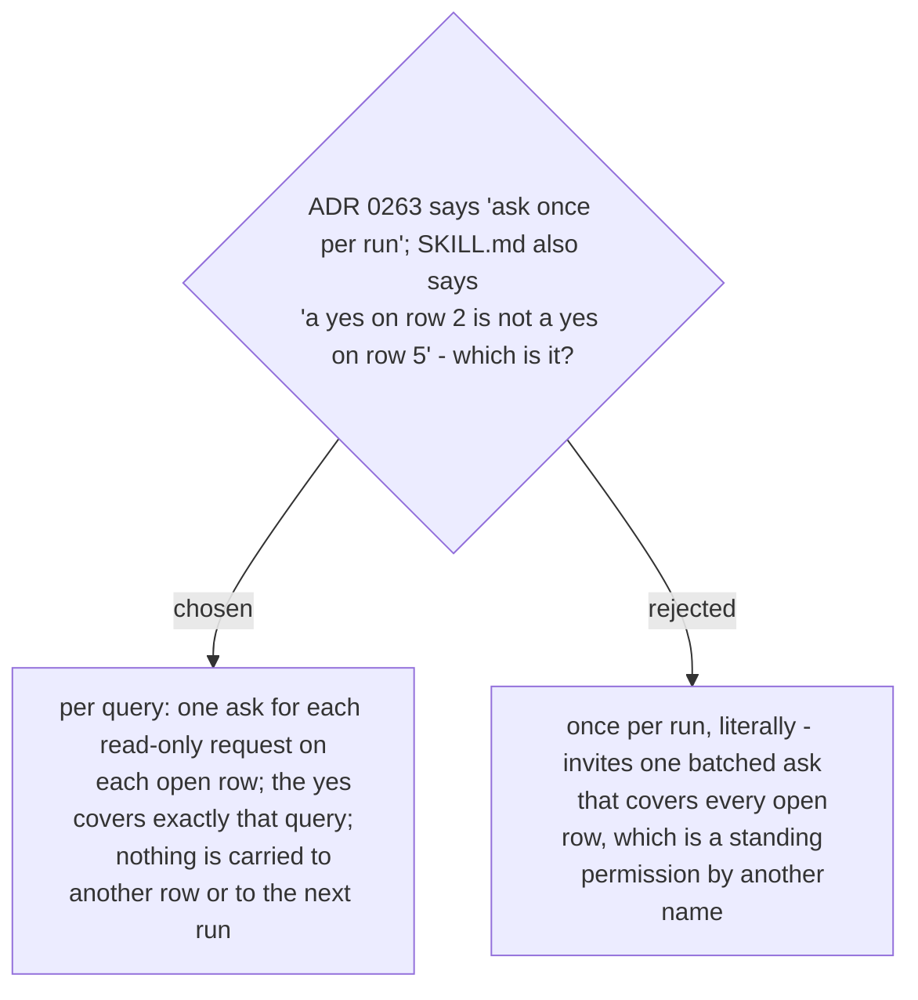

# The live-read ask is per query: a yes is never carried to another row or another run

Ruled 2026-10-29 at the final whole-branch review (deferred minor from the Task 1 review).
ADR 0263's "once per run" meant "not a standing permission"; the wording let an agent read
it as "one ask covers the run". The wording in `SKILL.md` phase 3 and its rules list is now
"once per query", which is what ADR 0263 intended.
