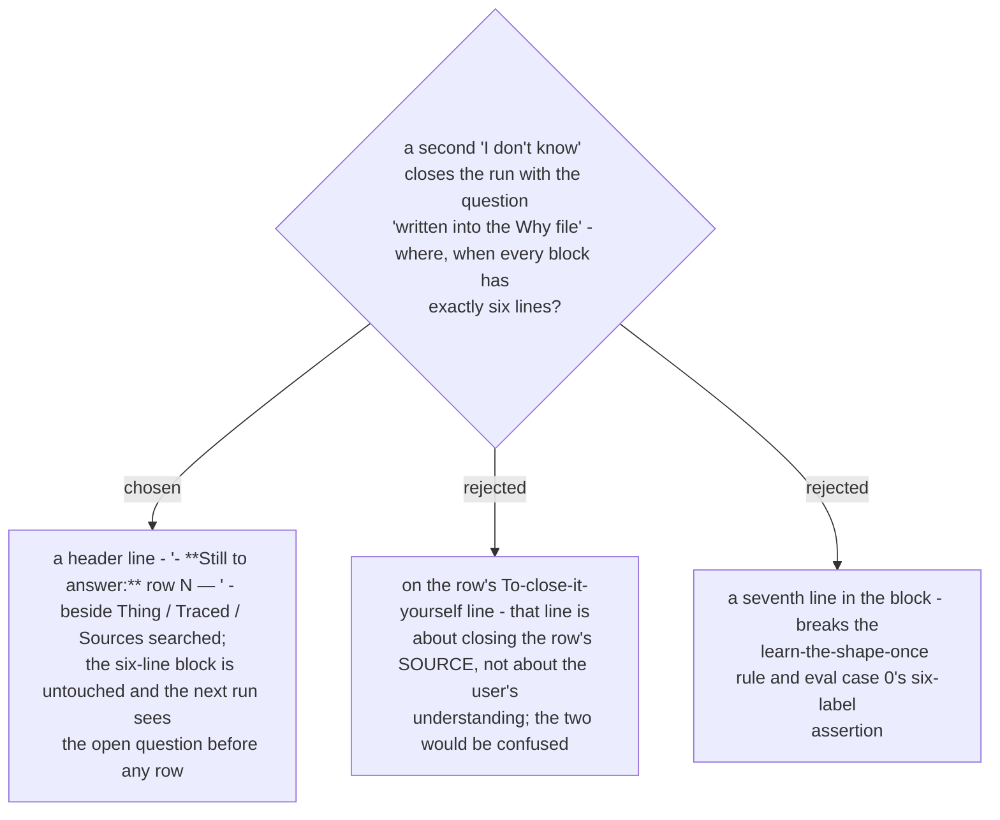

# An unanswered question lives on the Why file's "Still to answer" header line, not in a seventh block line

Ruled 2026-10-29 at the final whole-branch review (deferred minor from the Task 1 review,
re-placed by the final reviewer). ADR 0267 says the question is written into the file; ADR
0268 fixes the block at six lines. The header is the only place that satisfies both.
