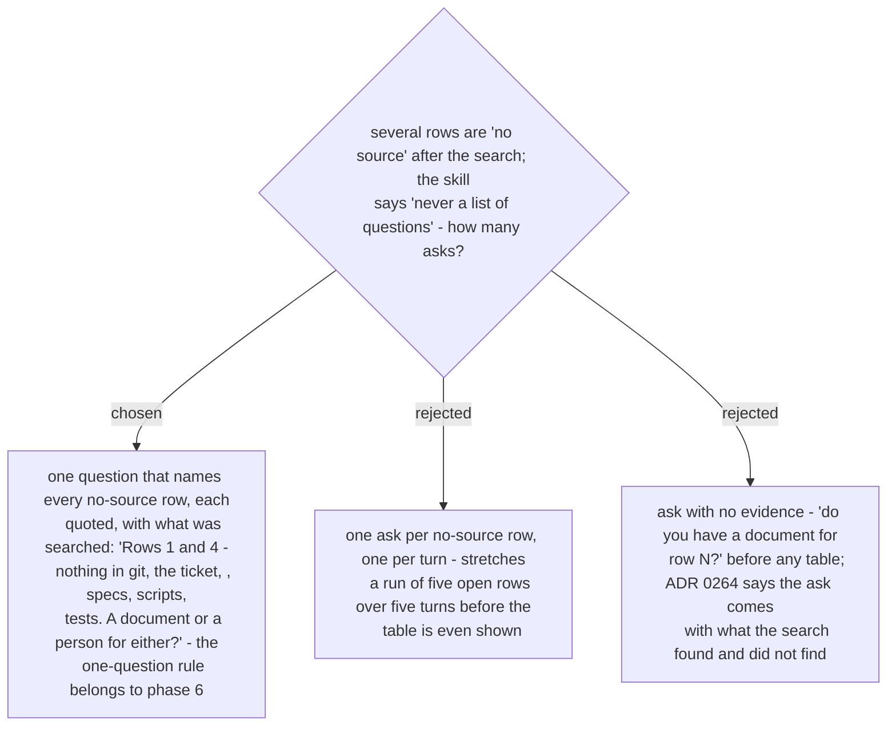

# Phase 3 asks one question naming every no-source row, with what was searched

Ruled 2026-10-29 at the final whole-branch review (deferred minor from the Task 1 review,
merged with the final reviewer's note that the phase-3 ask showed no evidence). ADR 0264 is
unchanged in substance - search first, ask only for open rows; this fixes the shape of that
ask and scopes "never a list of questions" to phase 6 (ADR 0267).
