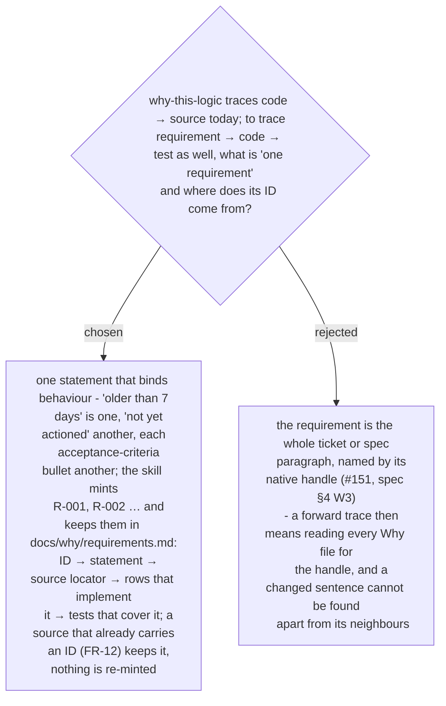

# A requirement is one behaviour-binding statement with a minted ID in a per-project register

Chosen 2026-10-29. The owner asked that `why-this-logic` carry "the requirement trace
ability of a software engineer" - forward and backward, with a matrix. A per-function
answer was rejected for the backward direction in ADR 0261 for the same reason this
rejects a per-ticket requirement: the unit must be the smallest thing that can change on
its own. The ID shape follows `architect-and-verify`'s `N-01` / `C-01` rows, where one ID
sits on the row, the arrow and the test; the forward / backward rule follows
`generating-test-cases` ("every requirement → ≥1 case; every case → real evidence").

The register is one file per project, beside the Why files, so a requirement that several
functions implement is one row with several pointers, not one row per Why file.

An ID is never reused for another statement and never renumbered once merged. The next
`R-nnn` is the highest number in the register across every branch and worktree - the same
global-max rule ADR 0056 sets for ADR numbers - re-checked before merge; a collision between
two unmerged branches is resolved by the later branch re-minting its own new IDs and updating
its own Why files, allowed only because those IDs were never shared.

A source's own ID is used as is only when it is unique across the project (`FR-12`); an ID unique only inside its ticket or document is qualified by it - `#151/AC-2` - so two tickets' second criteria never share a line (amended 2026-10-30 at the whole-plan review).
