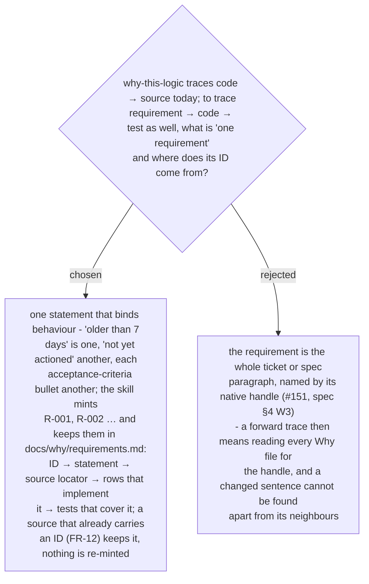

# A requirement is one behaviour-binding statement with a minted ID in a per-project register

Chosen 2026-10-29. The owner asked that `why-this-logic` carry "the requirement trace
ability of a software engineer" - forward and backward, with a matrix. A per-function
answer was rejected for the backward direction in ADR 0261 for the same reason this
rejects a per-ticket requirement: the unit must be the smallest thing that can change on
its own. The ID shape follows `architect-and-verify`'s `N-01` / `C-01` rows, where one ID
sits on the row, the arrow and the test; the forward / backward rule follows
`generating-test-cases` ("every requirement → ≥1 case; every case → real evidence").

The register is one file per project, beside the Why files, so a requirement that several
functions implement is one row with several pointers, not one row per Why file.
