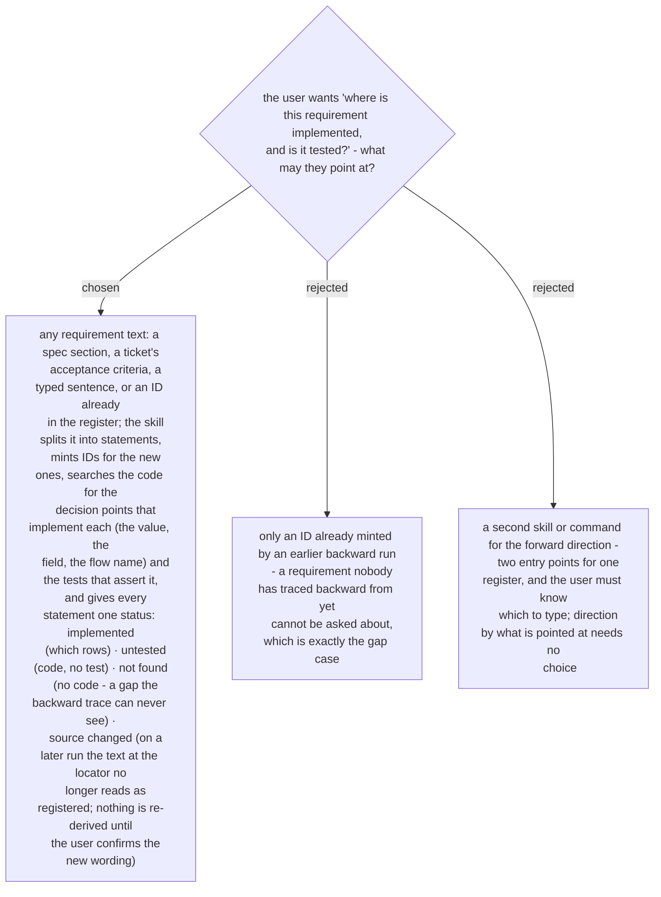

# The forward trace starts from any requirement statement, and reports implemented, untested, not found or source changed

> **Amended 2026-10-30 (whole-plan review):** when the thing pointed at could go either way, the question decides - *why / where does it come from / is it right* runs backward, *where is it implemented / is it tested / coverage* runs forward, neither → the one direction question; the four status words stay in English beside the verdict words; a *source changed* line keeps `<new text> (was: <old text>)` in its statement cell.

Chosen 2026-10-29. The backward run (ADR 0261–0277) can only start from code that exists;
a requirement with no code behind it - spec §4 Workflow 3's "emails the PDF digest to
`MG_AdminEmail`" on `Elevate` #151, say - has nothing to point at. The forward run is the
direction that finds it. The same skill carries both: what the user points at decides the
direction - a decision point or a thing with logic in it runs backward; a requirement
statement or an `R-` ID runs forward.
