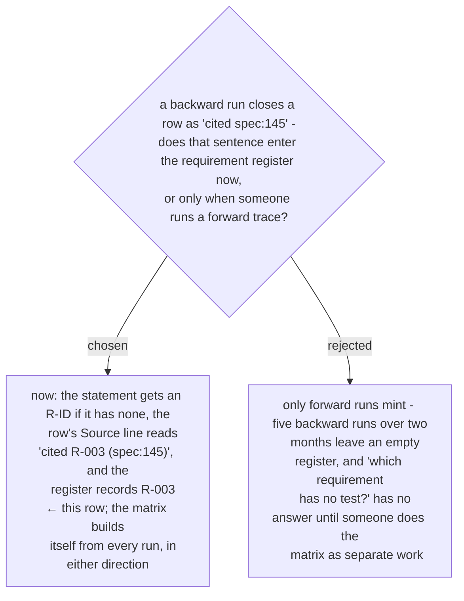

# Every row cited against a document mints or reuses a requirement ID, so the register grows from daily work

> **Amended 2026-10-29 (Task 2 review):** a row closed against a document statement still runs search order 6, so that a test asserting its value lands in the register's *tested by*; without that, the backward run could never fill the column this ADR exists to fill.

Chosen 2026-10-29. The cost is one register line per cited row; the gain is that the
*tested by* column is visibly empty for every requirement the daily work has touched,
without a separate traceability exercise. A row cited against a commit, a test or a person
mints nothing - only a document statement is a requirement (ADR 0278); a test is a
coverer, a commit is an origin (ADR 0270), a person's word is *told* (ADR 0266).
