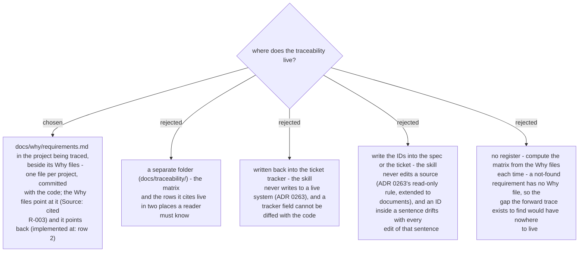

# The register lives beside the Why files in the traced project, and is never written to a tracker

> **Amended 2026-10-29 (Task 2 review):** `docs/why/requirements.md` is reserved for the register; a thing that would take that name gets `why-requirements.md`.

Chosen 2026-10-29. The register is read column-wise as the traceability matrix: an empty
*tested by* cell is `generating-test-cases`' work, an empty *implemented at* cell is a gap.
Both directions resolve inside one folder of one repo, which is what lets a new developer
open `docs/why/` and find everything.
