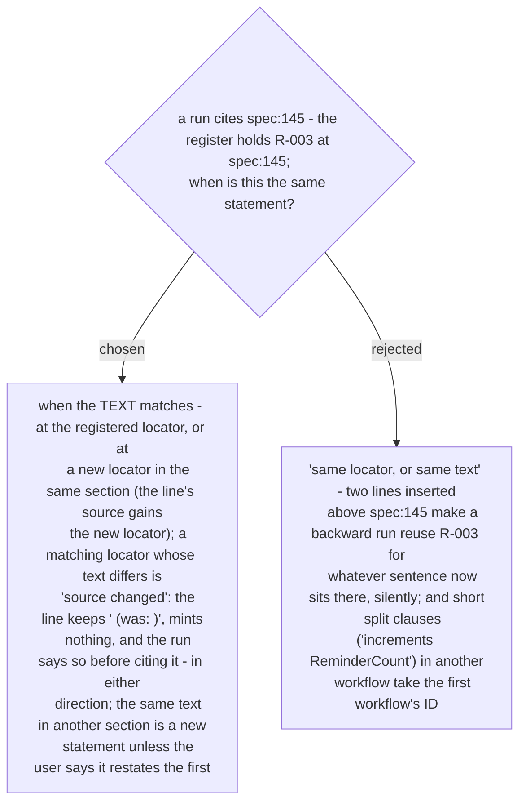

# A registered statement is matched by its text, never by its locator alone

Ruled 2026-10-30 at the whole-plan review. The previous wording came from the plan and was
copied into `SKILL.md` phase 2, F2 and the register template. The backward run had no
*source changed* path at all - only a later forward run compared text. Now both directions
compare the text first; a locator is a pointer to where the text was last seen, never the
identity. Eval case 6 measures the backward side: a known locator whose text changed.
