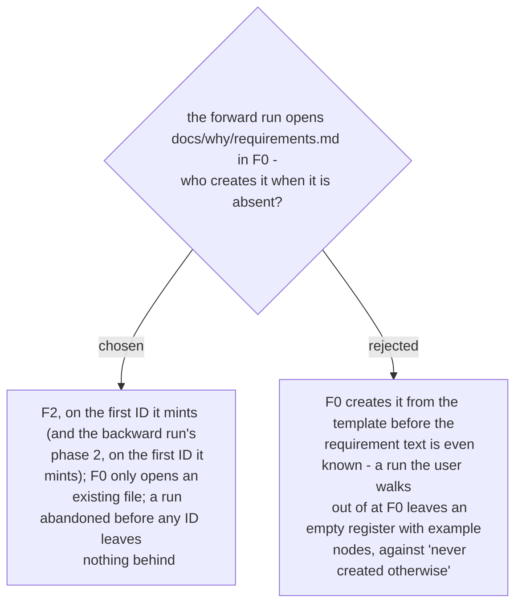

# The register is created by the first minted ID, never by an empty open

Ruled 2026-10-29 at the Task 2 review (deferred to this ADR by the whole-plan review on
2026-10-30). The spec §6 F0 said "open or create"; the skill now reads "open if it exists;
it is created in F2, by the first ID minted". Same rule for the backward run (ADR 0280).
