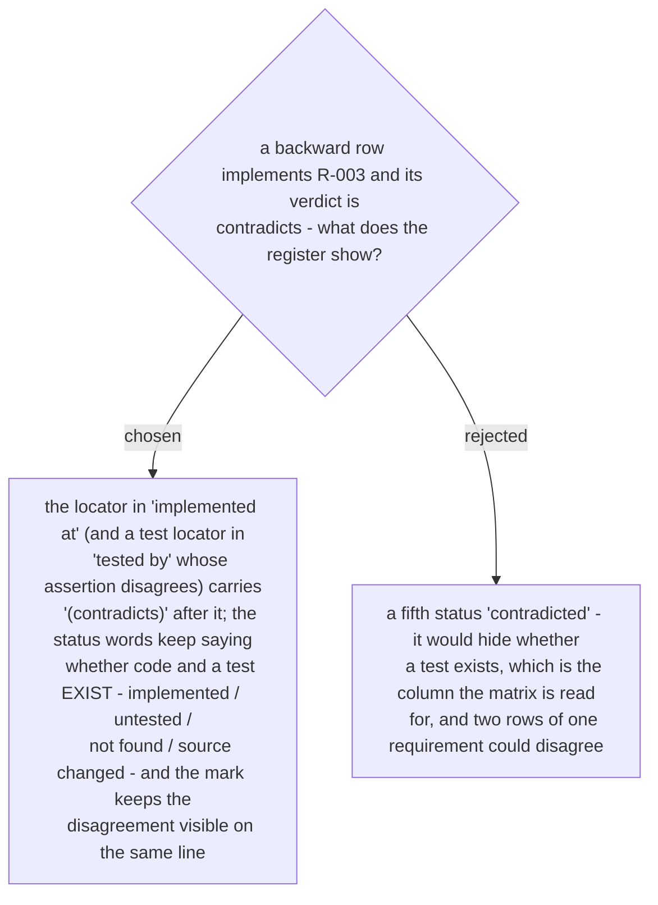

# `contradicts` is a mark on the locator, not a fifth status

Ruled 2026-10-29 at the Task 1 review (Minor 3a), promoted to an ADR by the whole-plan
review on 2026-10-30, which added the test-locator half: a test that asserts a value the
requirement does not say is coverage of the wrong value, and is marked too.
