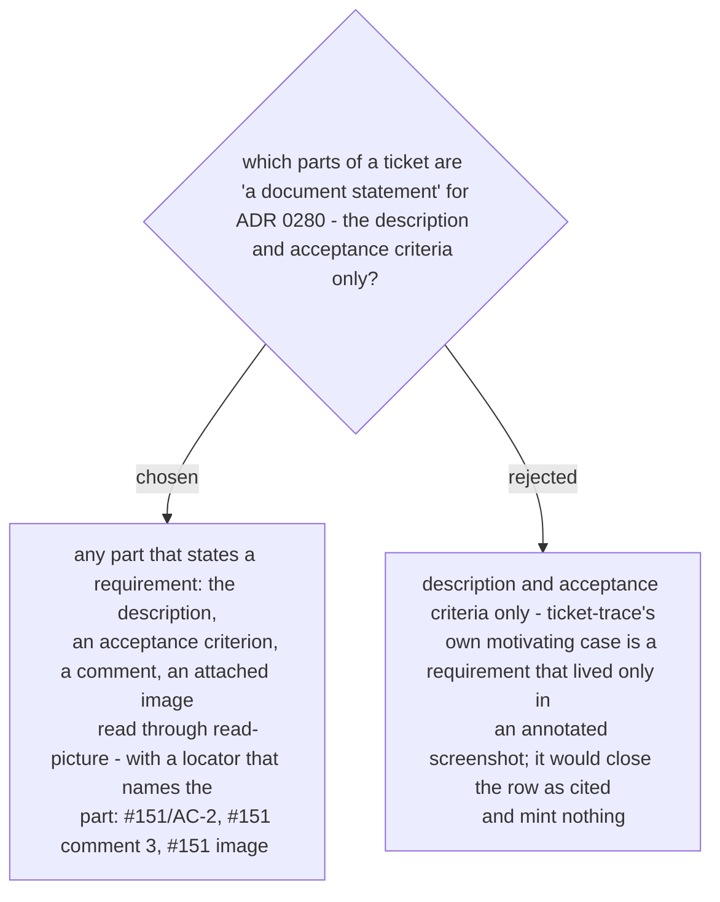

# A ticket comment or an attached image that states a requirement mints an ID

Ruled 2026-10-29 at the Task 2 review (Minor M6), promoted to an ADR by the whole-plan
review on 2026-10-30. Consistent with phase 2 order 2 ("a requirement is often only an
annotated screenshot") and with the locator-form rule of ADR 0278 as amended.
