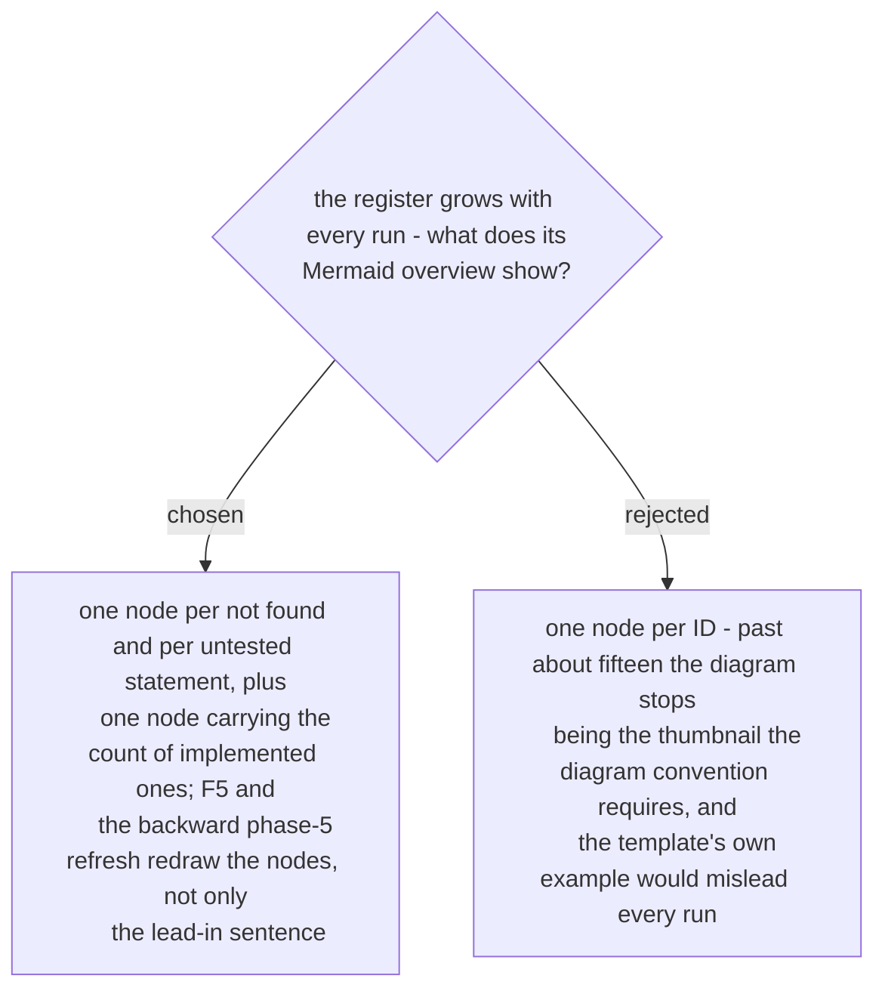

# The register's overview draws one node per open statement and one count node for the implemented ones

Ruled 2026-10-29 at the Task 3 review (Minor 4), promoted to an ADR by the whole-plan
review on 2026-10-30, which found the template's example still drawing an implemented ID
as its own node and no forward step redrawing the nodes - both fixed in the same wave.
