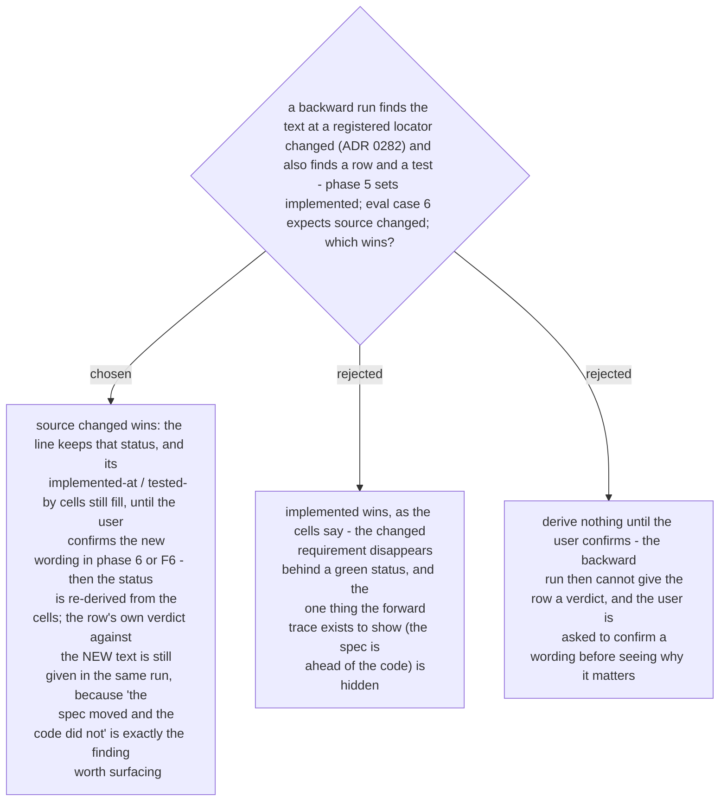

# `source changed` outranks `implemented` and `untested` until the user confirms the new wording

Ruled 2026-10-30 at the fix-wave re-review (new breakage NB-1), which traced eval case 6
through the amended phase 2 and found phase 5's refresh ("`implemented` when a test is in
*tested by*, else `untested`") had no third outcome. The status table's "re-derive nothing
until the user confirms" meant the *status*, not the row's verdict; this ADR says so. Text
in `SKILL.md` phase 5, the status table and `register-template.md` follows in the next change.
