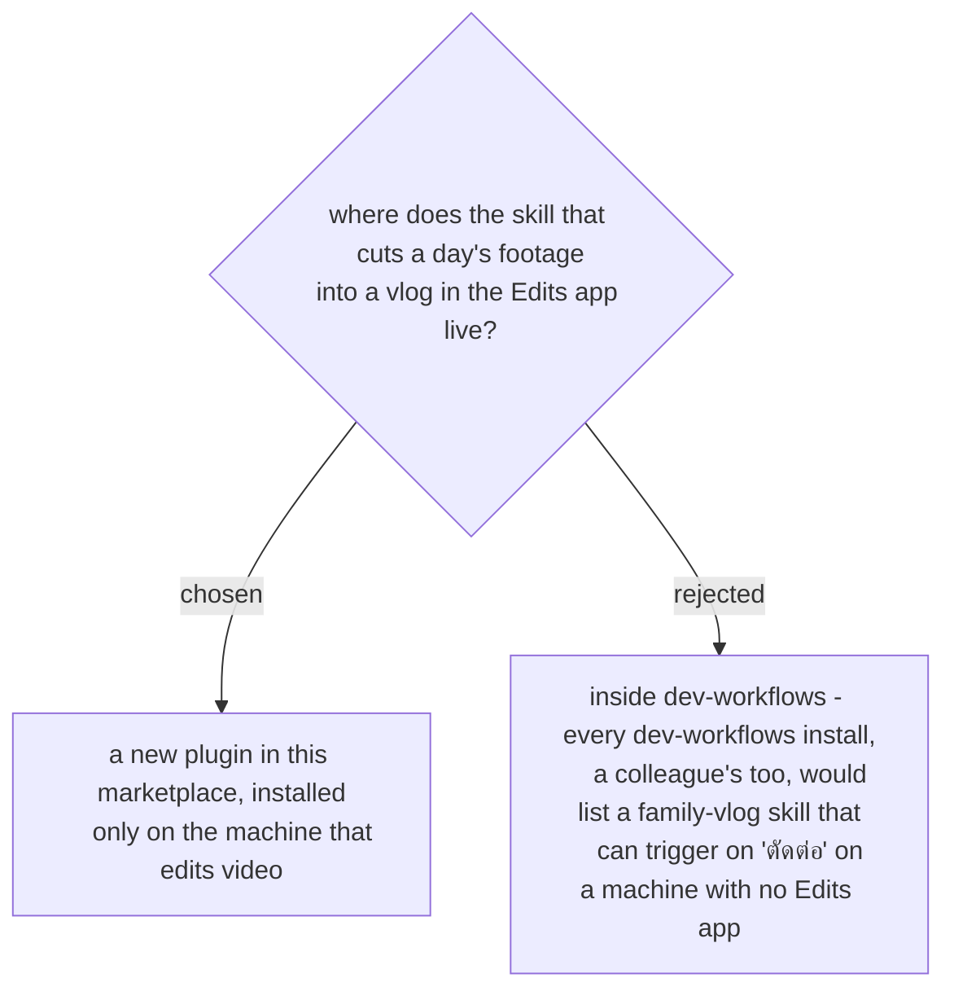

# Video editing ships as its own opt-in plugin

The skill drives Meta's Edits app on a Mac through the app's own MCP server, and it
cuts family footage. Neither has anything to do with the daily dev-work arc that
`dev-workflows` carries. It follows the `react-workflows` precedent: a separate plugin
that you install only where it applies, so it does not trigger anywhere else. Decided by
the user on 2026-11-07, in the grilling session that designed the skill.
