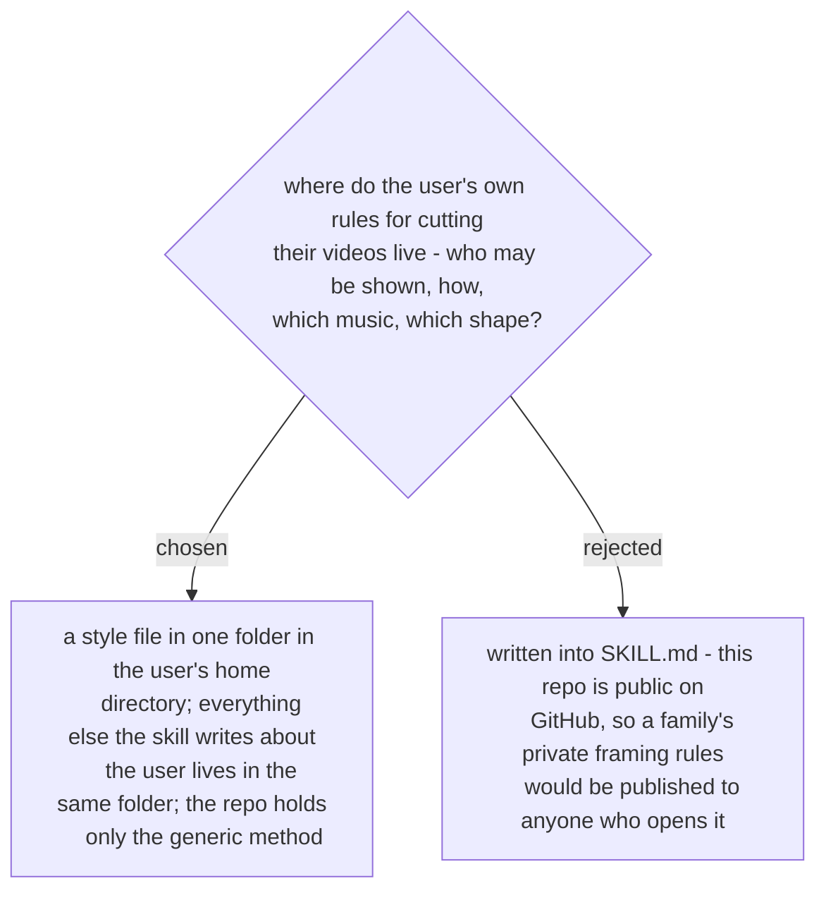

# Every user-specific file lives in a folder outside the repo

The repo is public (checked 2026-11-07). The rules the user gave while their first vlog was
cut are about their own family, and some are private: how one person may or may not be
framed, and why. They must not reach GitHub. The skill therefore carries only the method
(read the style file, apply its rules, check every shot against them before export). The
rules themselves live in a style file in a folder under the user's home directory, and
every other file the skill keeps about this user goes in the same folder. A first run with
no style file asks the user and writes one; a correction the user makes later ("keep that
person out of close-ups") is added to it. It follows the precedent of practice-english-writing's mistake
profile, which lives at `~/.claude/practice-english-writing/profile.md` for the same kind
of reason. Specs, plans, ADRs and eval cases for this skill use neutral examples, never this
family's rules. Decided by the user on 2026-11-07.
