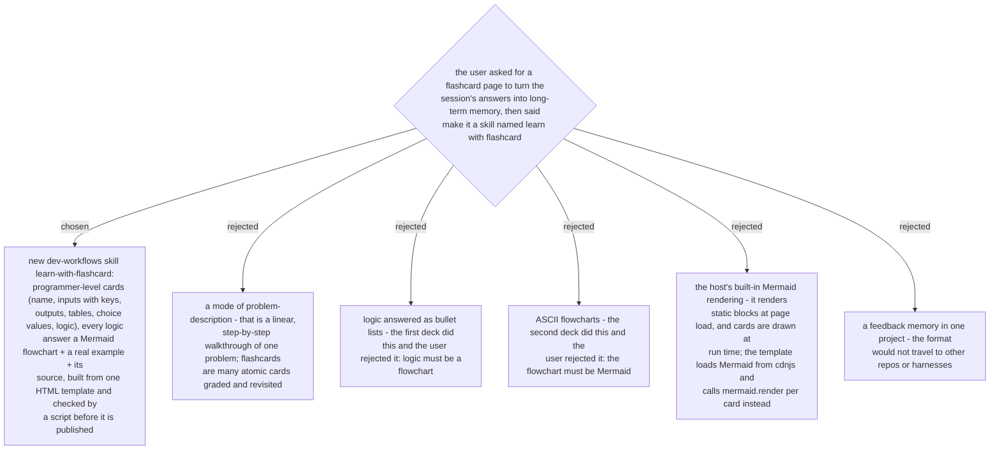

# learn-with-flashcard is its own skill, with Mermaid flowcharts for logic

Ruled 2026-11-07 by the user (Pon), in the MG-AI-Creditor-Enquiry-Agent session about the
phone-log flows (ADO #148-#150). The first deck answered logic with lists; the user said
"แก้ใหม่ logic ต้องเป็น flowchart" and asked for programmer questions ("flow แรก ชื่ออะไร
รับค่าอะไร return ค่าอะไร และ logic เป็นไง"). The second deck drew ASCII flowcharts; the user
said "flow chart ต้องเป็น mermaid diagram". Then: "create the skill from this ... the name
skill is learn with flashcard". The skill's worked example is that third deck, verbatim
(`assets/example-phone-log-flashcards.html`); the template is the same page with sample cards.
