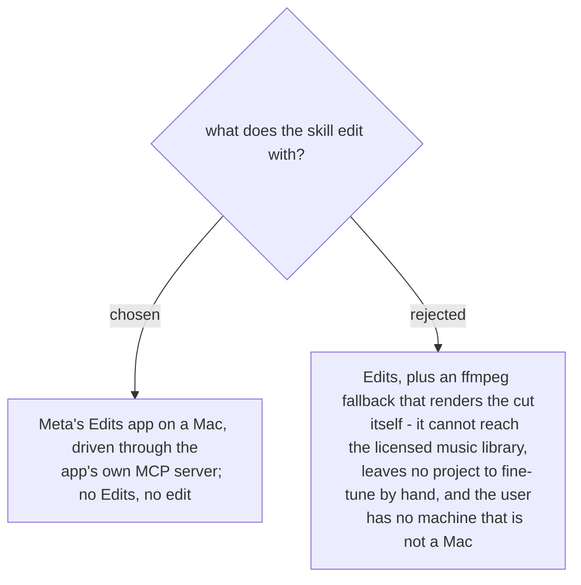

# The skill edits only in the Edits app, on a Mac

What made the first vlog work came from Edits: popular licensed songs, reframing and zoom
inside the app, and the app's own renders, which were the only way to measure the beat of a
licensed song. An ffmpeg path would lose all three and is the size of a second skill. The
user has only Macs (2026-11-07), so a fallback for a machine without Edits serves no one.
When Edits or its MCP server is not available, the skill says so and does not try another
way to edit. Decided by the user on 2026-11-07.
