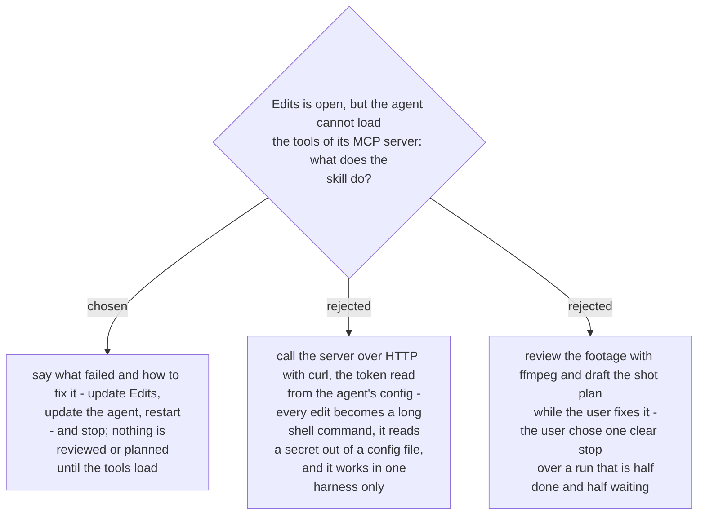

# When the Edits tools do not load, the skill stops

On the first run (2026-11-07) Claude Code connected to the server but rejected its tool
list (`tools/list`: `ttlMs` expected a number, `cacheScope` not `public`/`private`). The
agent worked around it with `curl` until the tools loaded. The skill does not repeat that:
a pre-flight loads the tools before any other step, and when it fails the skill names the
error and the fixes, then stops. Decided by the user on 2026-11-07.
