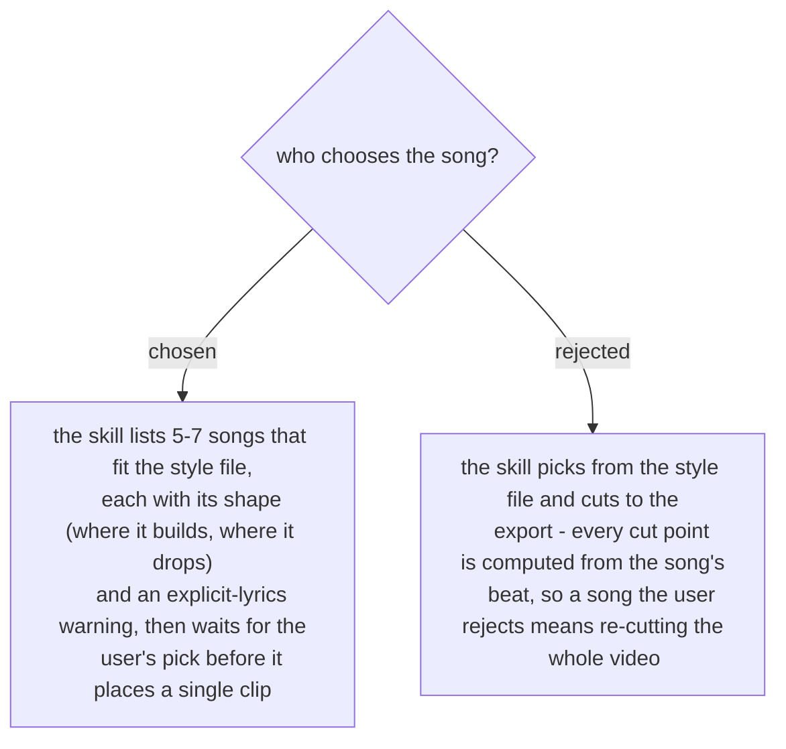

# The user picks the song from a list before any cut

On the first run (2026-11-07) the user rejected the first song after it was cut. Changing
the song meant deleting all 21 clips and cutting them again, because the shot lengths and
the drop point came from the old song's beat. The user then asked for a list first
("ลองลิสมาก่อน") and picked from it. One round of waiting at the start costs less than a
re-cut at the end. Decided by the user on 2026-11-07.
