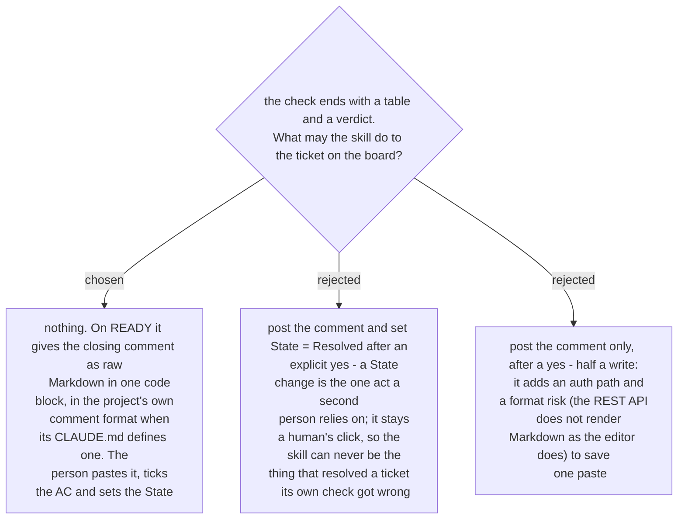

# resolve-the-ticket never writes to the tracker; on READY it drafts the closing comment

Ruled 2026-11-16 by the user (Pon), taking the recommended option. The skill is read-only
against the tracker in both moments, as `why-this-logic` is (ADR 0281). On NOT READY no
comment is drafted - there is nothing to close. The draft follows the traced project's own
comment rules where they exist (the user's project fixes a shape in its `CLAUDE.md`: a
result heading with the UTC time, how it was checked, an `| Item | Result |` table, and
"details in the runbook" instead of a copy of it).
