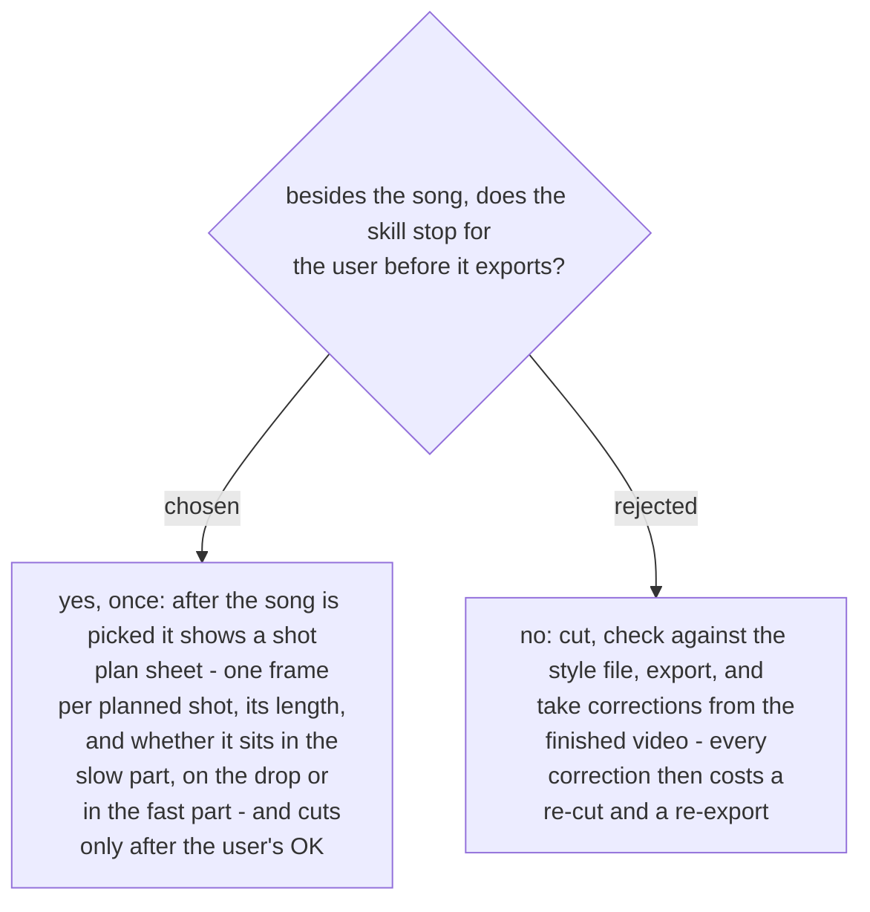

# The user approves a shot plan sheet before the cut

On the first run (2026-11-07) nearly every correction the user made after export could be
seen in a still frame: a person framed against the style file's rules, a moment out of
focus, a moment the user wanted longer. A sheet of one frame per shot shows all three
before a clip is placed, so they are fixed in the plan instead of in a re-cut. A still
cannot show how the cut feels against the music; that is still judged from the exported
video. Decided by the user on 2026-11-07.
