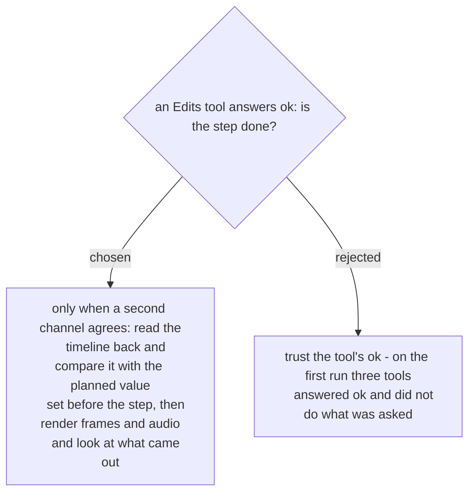

# Every edit step is checked against the plan in a second channel

On the first run (2026-11-07) three Edits tools reported success for an edit that did not
happen: `trimClip` with a negative delta returned `trimmed: true` and changed nothing,
`setTransform` with `fitMode: fill` clamped the scale back to 1, and deleting every clip
also deleted the music, without a word. Each was caught only because the timeline was read
back. This is guide-and-verify's "saved is not applied" trap, so the skill copies that
skill's method; it does not load guide-and-verify, because here the agent edits and no
person clicks. For each step: read the state before, write down the value the plan
expects (a clip's start, its source in and out, the music's in-point, the drop on a cut),
act, then read the timeline back and compare. Before export, render one frame of every shot
and the audio around the drop, and look at them against the style file. Decided by the user
on 2026-11-07.
