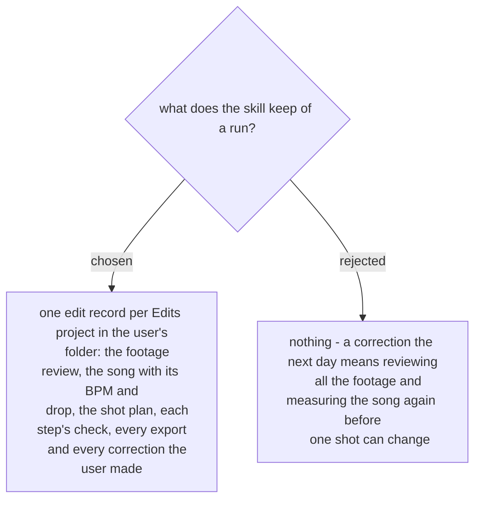

# One edit record per project, in the user's folder

> **Amended by
> [ADR 0314](workflow-daily-work-0314-cut-vlog-keeps-its-files-in-the-video-editing-folder.md)
> (2026-11-08):** the record is kept in `~/Movies/<project>/`, named by the project's name, not beside the style file in `~/.claude/cut-vlog/`; the style file moved to `~/Movies/cut-vlog/style.md`.

The slow parts of a run are the footage review and measuring the song: on the first run
(2026-11-07) the review alone took about ten minutes for 38 clips. A correction such as
"make the beach shot longer" changes one row of the shot plan. With the record, the skill reads
the plan back, changes that row, re-cuts only what moved, and checks it. Without it, the run
starts again from the footage. The record lives beside the style file, in the folder outside
the repo (ADR 0291), because it describes the user's own footage. Decided by the user on
2026-11-07.
