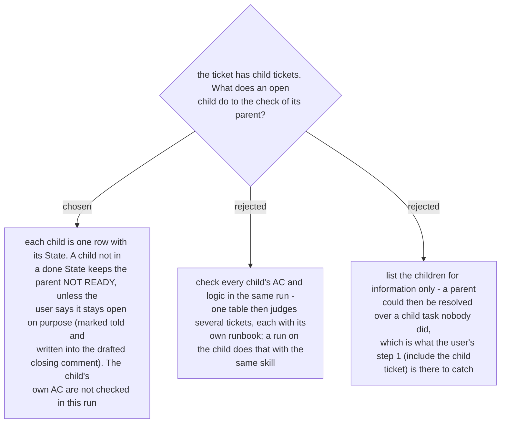

# An open child keeps the parent not ready; a child's own criteria get their own run

Ruled 2026-11-16 by the user (Pon), taking the recommended option. "Done State" is read from
the tracker's own state category, not from a fixed word - Resolved, Closed and Done differ
by process (see **Project** in `CONTEXT.md`). Amended by ADR 0307: a State named `Resolved`
also counts as done, because a measured process files it under the InProgress category. Real case used: #151 (User Story, Active) with
child #297 (Task, New).
