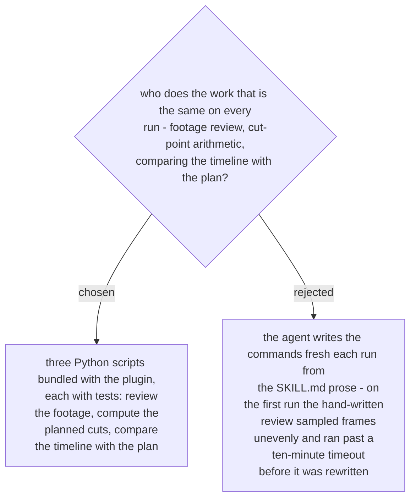

# Three tested Python scripts do the repeatable work

The three jobs are deterministic and the same every time. **Review** runs ffmpeg over a
folder of clips: eight evenly spaced frames per clip as one row, a loudness trace, and the
clips grouped into parts of the day by the gaps between their capture times. **Plan**
turns the song's BPM, the drop and each shot's length in beats into frame-exact cut times
and the trim values for each clip; those numbers are the planned values that the
second-channel check (ADR 0296) compares against. **Compare** reads the timeline the
agent saved from Edits and the plan, and names every shot that does not match. The scripts
never call the Edits MCP server: the agent calls the tools and passes their JSON to the
scripts, so the scripts can be tested without the app. Decided by the user on 2026-11-07.
