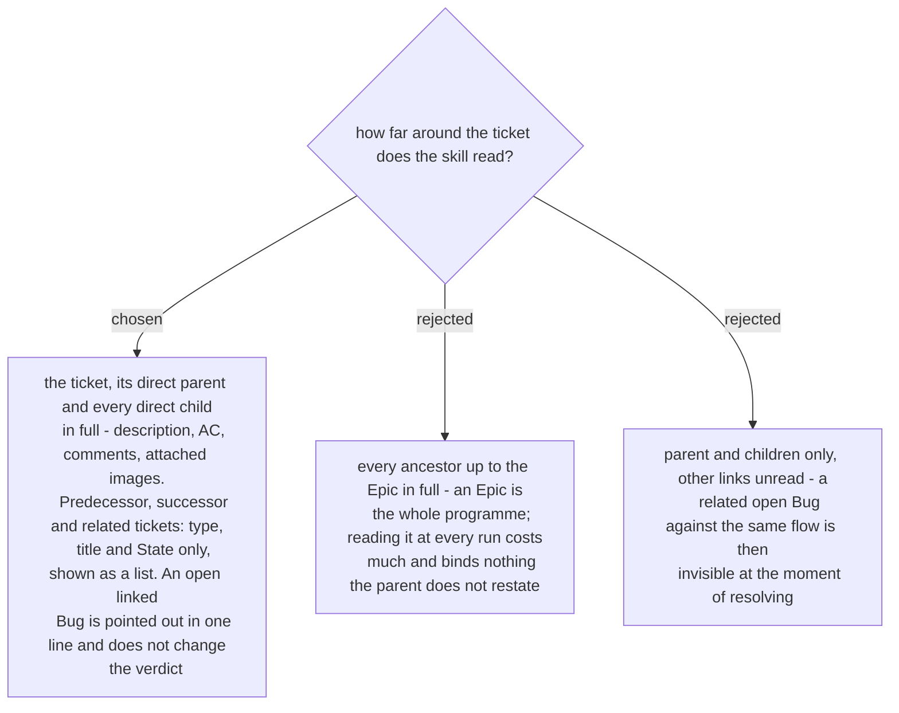

# The direct parent and children are read in full; other links by title and state

Ruled 2026-11-16 by the user (Pon), taking the recommended option. Real case used: #151 with
parent #147 (Feature), child #297 (Task), predecessor #272, related #145 and #295 (Bug); the
Epic #141 is not read. Tickets are fetched the way `ticket-trace` Operation B steps 4-5 do
it, images through `read-picture` - loaded, not duplicated.
