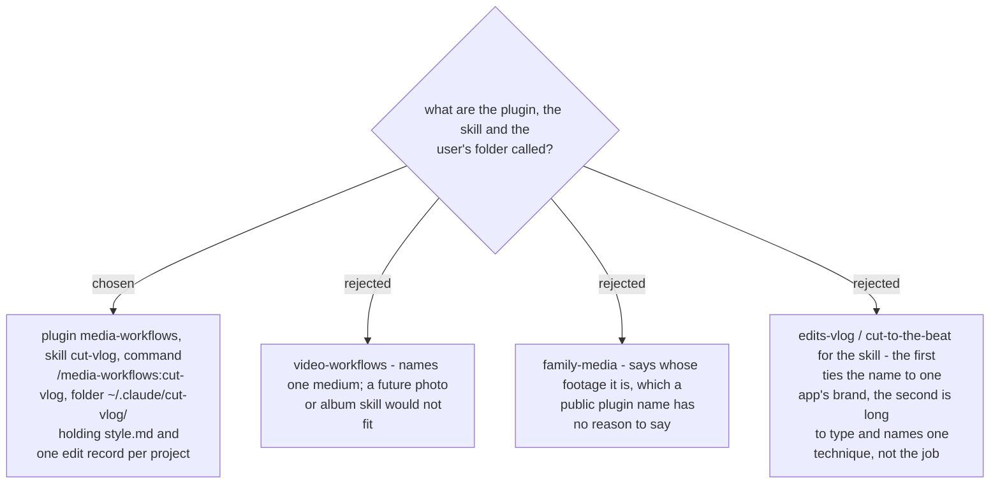

# The plugin is media-workflows, the skill is cut-vlog

The user folder follows practice-english-writing's `~/.claude/<skill>/` shape. The skill
also triggers on what the user would say ("ตัดต่อคลิป", "ตัดต่อ vlog", "cut my video"),
not only on the command. Decided by the user on 2026-11-07.
