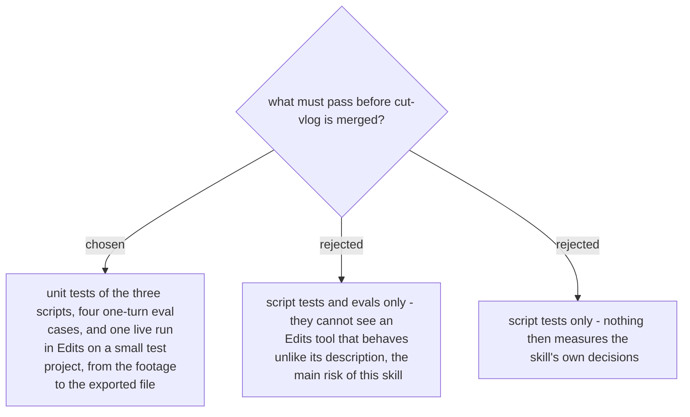

# cut-vlog is measured by script tests, four evals and one live run

The four eval cases measure the decisions a single turn can show: the tools do not load,
so the skill stops (ADR 0293); a first run with no style file asks only what the message
left open (ADR 0291); the skill lists songs and places no clip before the user picks
(ADR 0294); a correction the next day reads the edit record instead of reviewing the
footage again (ADR 0297). None of them can show what a real Edits tool does. On the first
run (2026-11-07) `setExportSettings` rejected `1080p` and `16:9` and took four attempts,
and three tools answered ok without doing the edit (ADR 0296). So one live run on 5-10
test clips, from review to export, is required before merge; the user opens Edits and
picks the clips. Eval prompts use neutral footage and people, never the user's family
(ADR 0291). Decided by the user on 2026-11-07.
