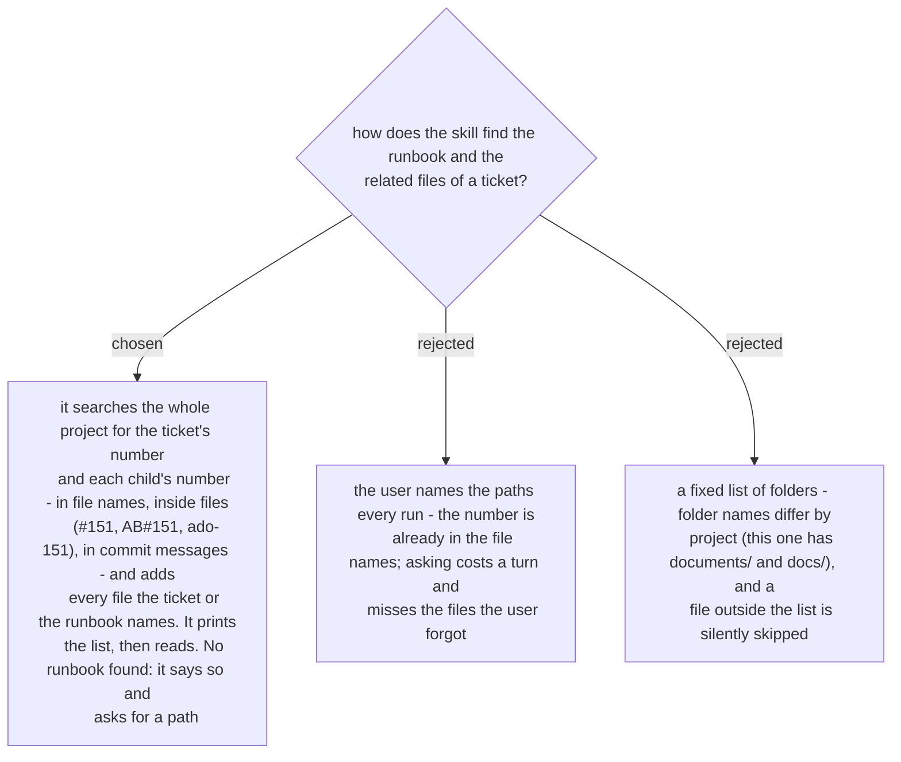

# Related files are found by the ticket number and listed before they are read

Ruled 2026-11-16 by the user (Pon), taking the recommended option. The number is matched as
a whole number with its usual prefixes, so `151` does not match `1510` or a date; a hit that
only shares the digits is dropped. Folders such as a snapshot directory are listed with a
file count and are not read file by file. "No runbook" is a stated fact in the briefing and
a question in the check - never a silent pass, because the runbook is where most written
test results live.
