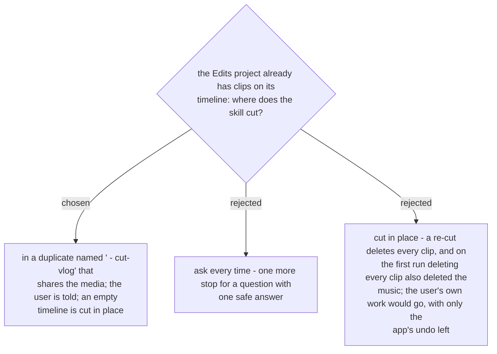

# A project with work on its timeline is duplicated first

> **Superseded in part by
> [ADR 0313](workflow-daily-work-0313-the-user-adds-the-song-by-hand-and-no-timeline-is-ever-emptied.md)
> (2026-11-08):** the user's own timeline is still never touched, but a busy project is now
> cut in a new empty project the user makes. A duplicate is allowed only if its timeline is
> never cleared — a project emptied once rendered and exported without sound.

The skill deletes and re-adds clips whenever a shot has to grow, because a clip cannot be
trimmed outward. On the first run (2026-11-07) the timeline was empty, so nothing was lost,
but deleting every clip also removed the music track without a word. Edits'
`duplicateProject` makes a copy that shares the media, so the copy costs no disk. The
skill cuts there and says so, and the user's own timeline is never touched. Decided by the
user on 2026-11-07.
