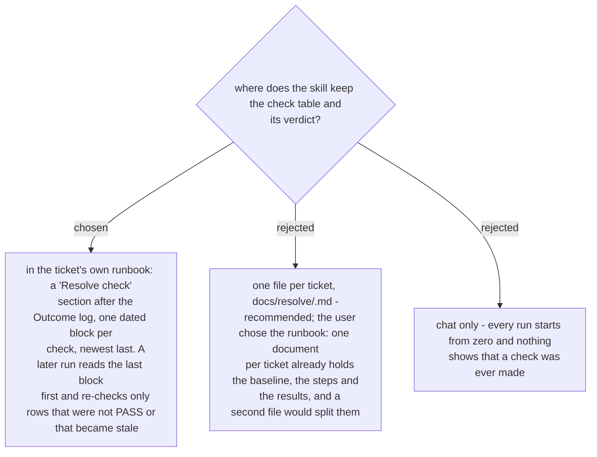

# The check is appended to the ticket's runbook, not kept in a file of its own

Ruled 2026-11-16 by the user (Pon): "Add it to the runbook". The cost named when the option
was offered is real and is handled by a rule, not ignored: the skill appends only - it never
edits a line above its own section - and it never reads its own earlier 'Resolve check'
blocks as proof of a pass; a row's proof is always the test result it points at. The section
is a table inside an existing runbook, so the document's own overview diagram stands and no
new diagram is added.
