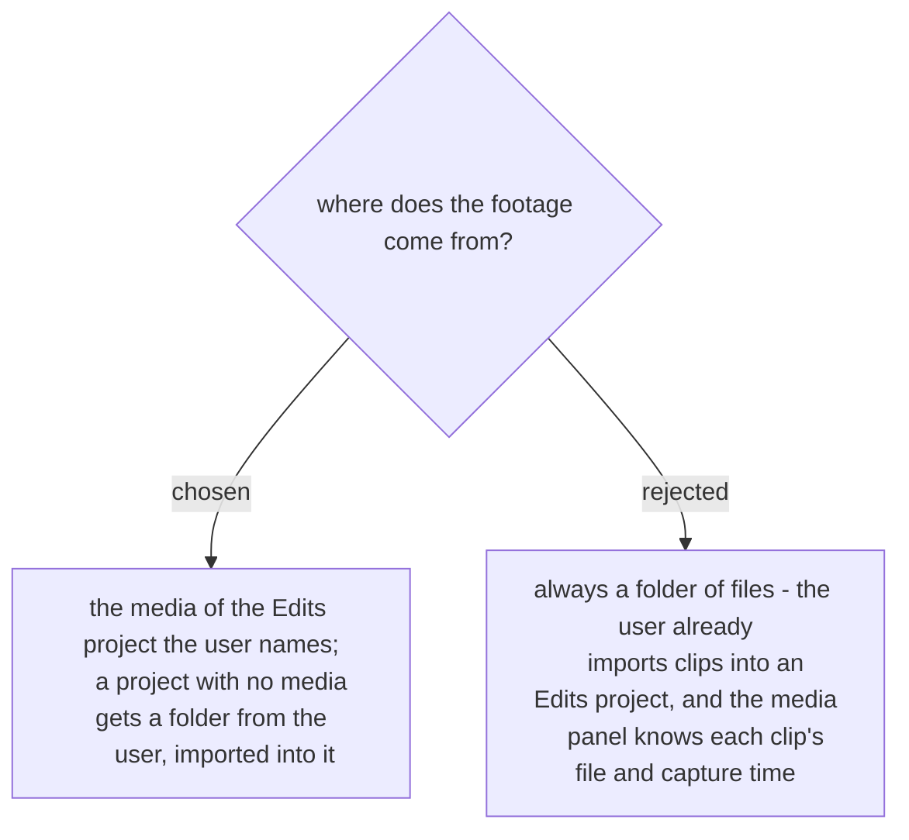

# The footage is the named Edits project's media

On the first run (2026-11-07) the user had already made a project named for the day and
imported 38 clips; the clips' source folder came from the project's own media list. The
skill starts from the project the user names. Only when it has no media does the skill ask
for a folder and import it. Agreed by the user in the recap on 2026-11-07.
