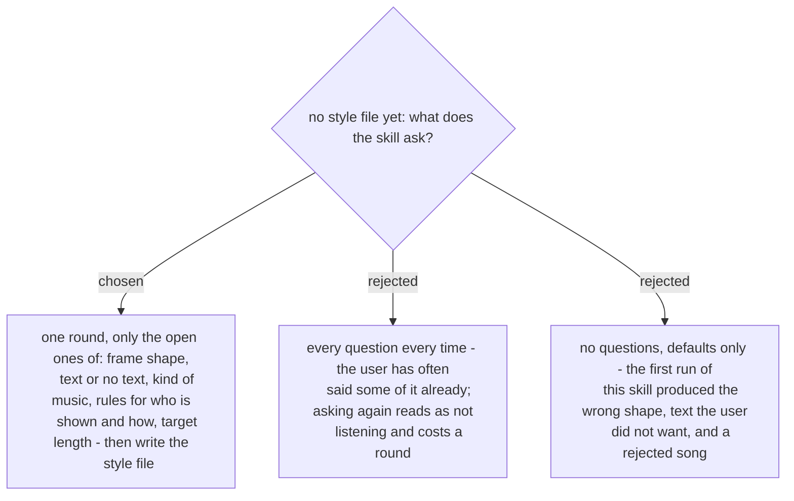

# A first run asks once, only what the user left open

It follows ADR 0260: a start question the user has already answered is not asked again.
The five questions are the ones the user's corrections on 2026-11-07 showed were missing:
portrait instead of landscape, text overlays, a song kind, how a person was framed, and
how long a moment should run. Agreed by the user in the recap on 2026-11-07.
