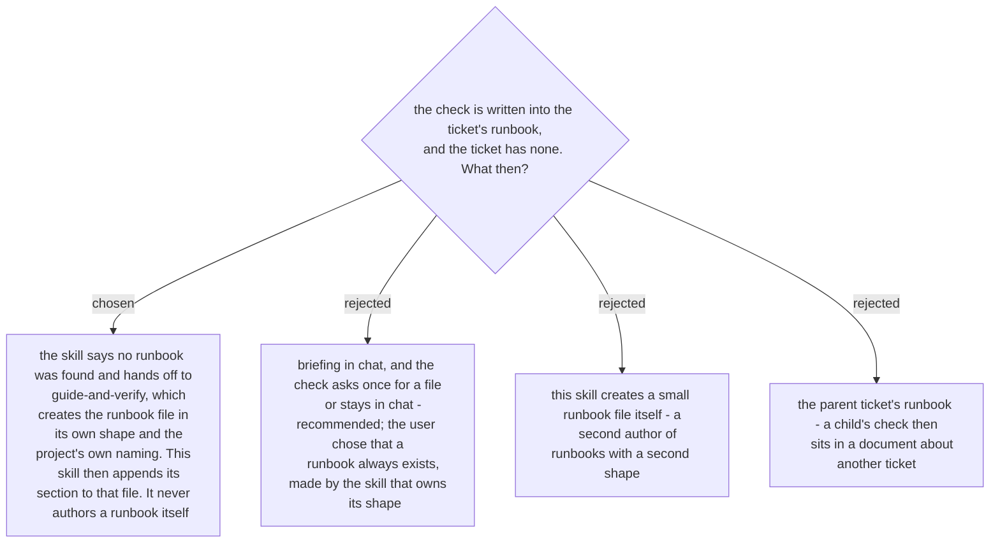

# A ticket with no runbook gets one through guide-and-verify, never from this skill

Ruled 2026-11-16 by the user (Pon): "use guid and verify to create runbook file". The
hand-off is by loading `guide-and-verify` through the harness's mechanism, with what this
skill has already read (the ticket, its parent and children, the file list) passed as the
head start, so nothing is fetched twice. Applying the hand-off at both moments - at the
briefing, where the runbook is about to be needed, and at the check - is the agent's reading;
the user's words name the skill and the file, not the moment.
