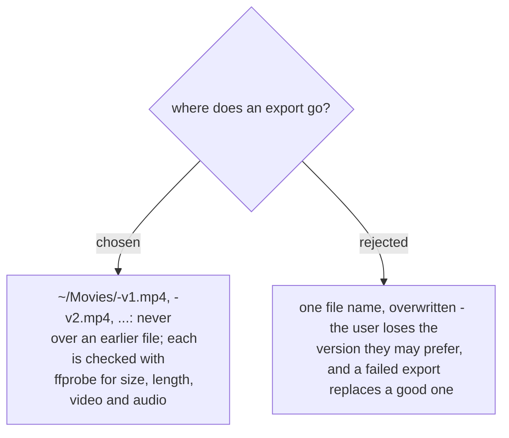

# Every export is a new numbered file

> **Amended by
> [ADR 0314](workflow-daily-work-0314-cut-vlog-keeps-its-files-in-the-video-editing-folder.md)
> (2026-11-08):** exports now go to `~/Movies/<project>/<project>-v<N>.mp4`, beside the edit record; still never over an earlier file.

On the first run (2026-11-07) the user went through three versions and compared them; each
was kept under its own name. A file on disk is not proof that the export worked, so each is
read back with ffprobe: 1920x1080 (or the style file's shape), the planned length, a video
stream and an audio stream. Agreed by the user in the recap on 2026-11-07.
