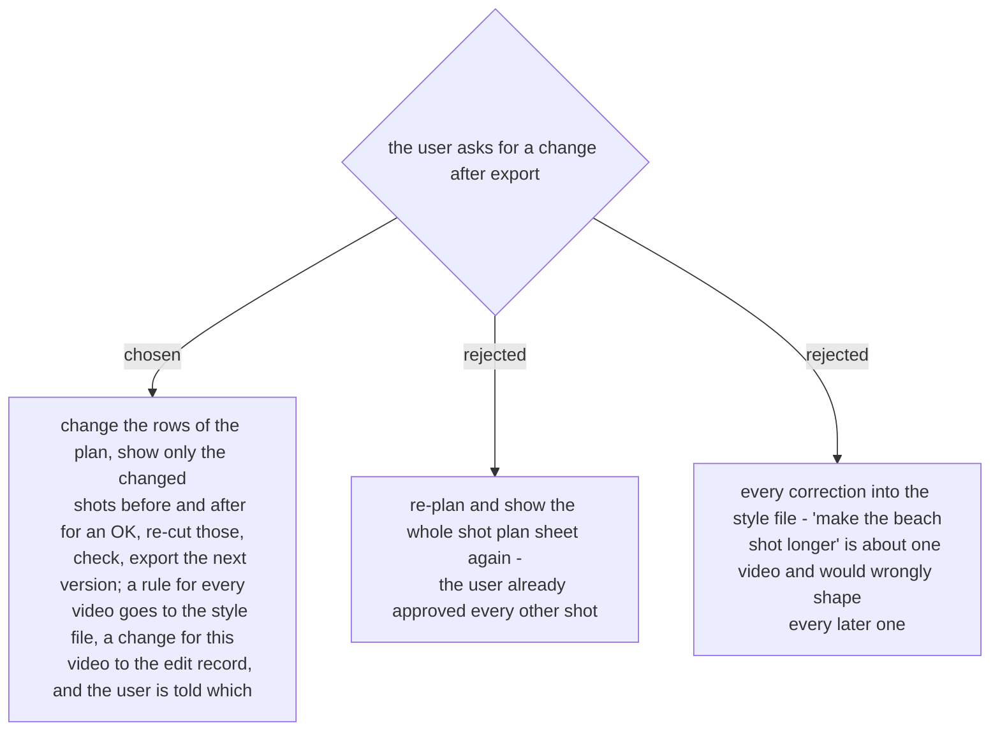

# A correction re-cuts only what moved

On the first run (2026-11-07) the corrections were of two kinds: rules for every video
(how one person may be framed, the kind of music) and changes to this video (a longer
moment, a sharper shot). The first kind belongs in the style file (ADR 0291), the second
in the edit record (ADR 0297). Agreed by the user in the recap on 2026-11-07.
